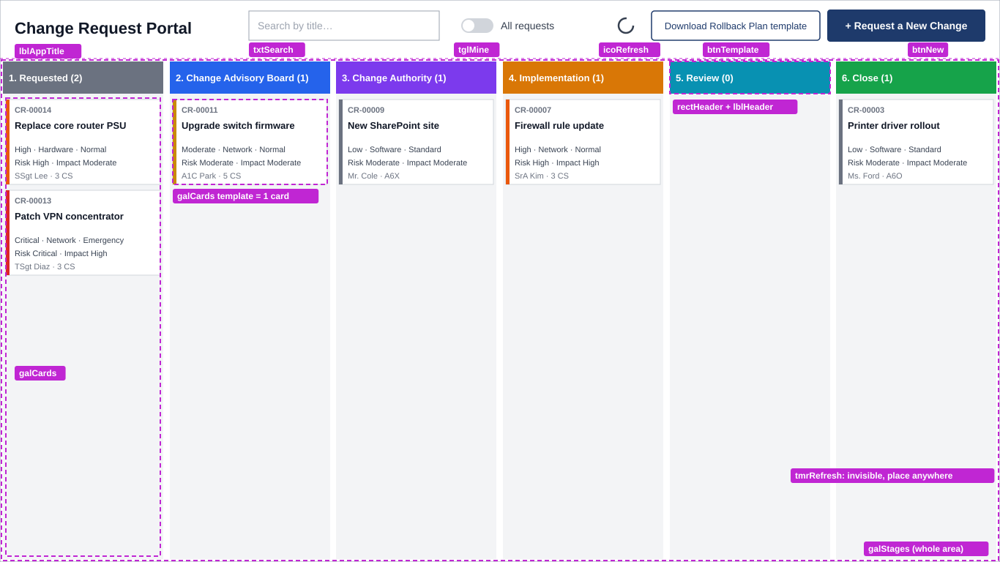
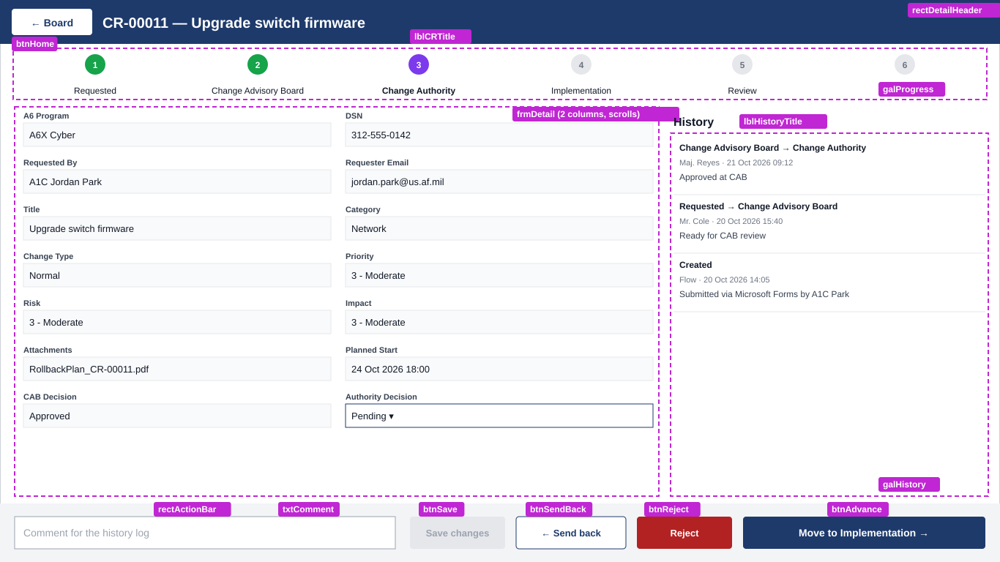
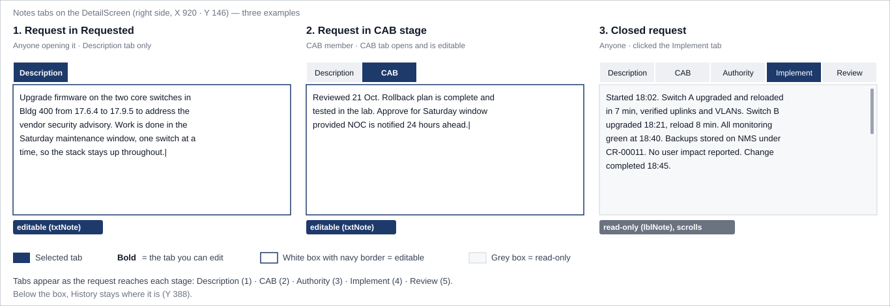

# Change Request Portal: Power Apps build guide

A canvas app that shows change requests as a board with one column per stage. Requests are submitted in the app, and each one moves through the stages on its change type's route.

| # | Stage | What happens | Rule before it can move on |
|---|-------|--------------|------------------|
| 1 | **Requested** | Requester submits the change | — |
| 2 | **Technical Review Board (TRB)** | TRB checks the technical plan, testing and rollback plan. *Normal changes only.* | `TRBDecision` = Approved |
| 3 | **Change Advisory Board (CAB)** | CAB reviews risk and impact | `CABDecision` = Approved |
| 4 | **Change Authority** | Authority gives the final sign-off | `AuthorityDecision` = Approved |
| 5 | **Implementation** | Assignee carries out the change and clicks **✔ Completed** | Implementation notes filled in |
| 6 | **PIR** | Post-implementation review | PIR outcome chosen |
| 7 | **Close** | Done (or rejected) | — |

**Routes by change type:**

| Change type | Route |
|---|---|
| **Normal** | Requested → TRB → CAB → Change Authority → Implementation → PIR → Close |
| **Emergency** | Requested → CAB → Change Authority → Implementation → PIR → Close |
| **Standard** | Requested → Implementation → Close |
| *Informational (older requests only)* | Requested → CAB → Change Authority → Implementation → PIR → Close |

**Architecture:**
- **Data:** two SharePoint lists, so no premium license is needed.
- **New requests:** submitted on the app's **New Request** screen, with a people picker for *Requested by*.
- **Tracking:** the board, detail screen and schedule are a Power Apps canvas app.
- **Audit trail:** every submission, stage move and comment adds a row to a history list.
- **Emails:** two Power Automate flows email the right people when a request is submitted and when it changes stage.

## Before you start

**Build order.** Total time is about a day the first time.

| Step | What | Time |
|---|---|---|
| 1 | SharePoint lists | 30 min |
| 2 | Create the app, connect the data, App.Formulas | 20 min |
| 3 | BoardScreen | 60 min |
| 4 | NewScreen (submit a request) | 2 hours |
| 5 | DetailScreen | 3 hours |
| 6 | Schedule screen ([Forward-Schedule-of-Change.md](Forward-Schedule-of-Change.md)) | 90 min |
| 7 | Publish and share | 15 min |
| 8 | Email notifications (Power Automate) | 90 min |
| 9 | Test checklist | 45 min |
| 10 | Troubleshooting | as needed |

**Government clouds.** If your organization is on GCC High or DoD, the sites are at different addresses:

| Service | Commercial / GCC | GCC High |
|---|---|---|
| Power Apps | make.powerapps.com | make.high.powerapps.us |
| Power Automate | make.powerautomate.com | make.high.powerautomate.us |

DoD tenants use different addresses again; ask your IT team for them. The top bar of Power Apps Studio shows your **Environment** (for example *United States Air Force*).

**How to set a property.** Every table in this guide uses this same routine:
1. Select the control in the **Tree view** on the left.
2. Choose the property in the dropdown at the left of the formula bar.
3. Type or paste the value into the formula bar, to the right of the **=**.

You can also type X, Y, Width and Height into the **Properties** pane on the right.

**Classic controls.** This guide uses the classic controls. If your **+ Insert** panel shows *Text label*, *Pen input* and *List box*, you're already using them. Their property names (`HintText`, `Fill`, `txtSearch.Text`, `tglMine.Value` and so on) match this guide.

**Control names in forms.** Each field in a form is a *card*. A card has a title label named `DataCardKey` plus a number, and a value control named `DataCardValue` plus a number. Date cards use `DateValueN`, `HourValueN` and `MinuteValueN` instead. The numbers are different in every app, so in this guide `DataCardValueN` means *the value control inside that card*. Expand a card in the Tree view to see its real names.

**Choice fields use classic Drop downs.** In this environment, the combo boxes Power Apps puts in choice cards show *Item 1, 2, 3* or nothing. So every choice field in this guide hides that combo box and shows a classic **Drop down** instead, fed by a list in App.Formulas. What's saved to SharePoint doesn't change. [Troubleshooting-Notes.md](Troubleshooting-Notes.md) explains how this was found.

**Quotes.** Type formulas directly or paste them from this guide. Don't paste through Word or Outlook. They turn straight quotes `"` into curly ones `“ ”`, which breaks formulas.

---

## Step 1 — Create the SharePoint lists

### Option A: script
Run [Provision-ChangeRequestLists.ps1](Provision-ChangeRequestLists.ps1) in PowerShell 7.4 or later:

```powershell
./Provision-ChangeRequestLists.ps1 -SiteUrl "https://<tenant>.sharepoint.com/sites/<site>" -ClientId "<your PnP Entra app id>"
```

It creates both lists with every column, the indexes, and uploads the Rollback Plan template. PnP PowerShell needs its own Entra ID app registration, which usually needs an admin. If you don't have one, use Option B.

### Option B: by hand

**Change Requests list:**
1. On your SharePoint site, choose **+ New › List › Blank list**, name it **Change Requests**, and click **Create**.
2. For each row in the table below, click **+ Add column**, choose the type, then click **Next**.
3. Type the **Column** name *exactly* as shown, with no spaces. That becomes the internal name the formulas use, and you can't change it later. You can rename the *display* name afterwards (e.g. "Impact details").
4. For Choice columns, enter each choice on its own line, set the **Default value**, and under **More options** turn *Can add values manually* **off**.
5. For "Multiple lines" columns, open **More options** and turn **Use enhanced rich text** **off**.
6. Click **Save**.

| Column | Type | Choices / default / notes |
|---|---|---|
| Title *(already exists)* | Single line | change title |
| CRNumber | Single line | e.g. `CR-2026-001`, set by the app on submit |
| Stage | Choice, **required** | Requested, Technical Review Board, Change Advisory Board, Change Authority, Implementation, PIR, Close · default **Requested** |
| A6Program | Single line | |
| DSN | Single line | |
| RequestedBy | Single line | the requester's name |
| RequesterEmail | Single line | the requester's email |
| SubmittedBy | Single line | sign-in email of whoever clicked Submit |
| Category | Choice | Hardware, Software, Network · default *none* |
| ChangeType | Choice | Standard, Normal, Emergency · default *none* |
| Description | Multiple lines (plain) | |
| ImpactDetails | Multiple lines (plain) | |
| Justification | Multiple lines (plain) | |
| Priority | Choice | 4 - Low, 3 - Moderate, 2 - High, 1 - Critical · default *none* |
| Risk | Choice | 3 - Moderate, 2 - High, 1 - Critical · default *none* |
| Impact | Choice | 3 - Moderate, 2 - High, 1 - Critical · default *none* |
| PlannedStart | Date and time | |
| PlannedEnd | Date and time | |
| Location | Single line | |
| AffectedSystems | Single line | |
| OutageExpected | Yes/No | default **No** |
| OutageDuration | Single line | free text, e.g. *30 minutes* |
| TRBDecision | Choice | Pending, Approved, Needs changes, Rejected · default **Pending** |
| TRBNotes | Multiple lines (plain) | |
| TRBRollbackReviewed | Yes/No | default **No** |
| TRBTested | Yes/No | default **No** |
| TRBSecurityReviewed | Yes/No | default **No** |
| CABDecision | Choice | Pending, Approved, Rejected · default **Pending** |
| CABNotes | Multiple lines (plain) | |
| AuthorityDecision | Choice | Pending, Approved, Rejected · default **Pending** |
| AuthorityNotes | Multiple lines (plain) | |
| Assignee | Person | |
| ActualStart | Date and time | |
| ActualEnd | Date and time | |
| ImplementationNotes | Multiple lines (plain) | |
| ImplementationComplete | Yes/No | default **No**, set by the Completed button |
| ReviewOutcome | Choice | Successful, Successful with issues, Failed, Rolled back, Rejected · default *none* (the PIR outcome) |
| ReviewNotes | Multiple lines (plain) | the PIR notes |
| ClosedDate | Date and time | |

Choice text must use a plain hyphen with a space on each side (`2 - High`), and match the lists in App.Formulas (Step 2) character for character.

> **Older lists:** lists built for the first version of the app also have a `FormResponseId` column, and may have `Informational` as a ChangeType choice. Leave both: older requests use them, and the app ignores them.

The Rollback Plan PDF and any additional files are stored as **attachments** on the list item. Attachments are switched on by default.

**Change Request History list:**
1. Create a second blank list named **Change Request History**.
2. Add these four columns:

| Column | Type | Settings |
|---|---|---|
| RequestID | Number | More options › decimal places **0** |
| FromStage | Single line | |
| ToStage | Single line | |
| Comment | Multiple lines | More options › *Use enhanced rich text* **off** |

3. The built-in **Title** column can't be deleted. Rename its display name to **CR Number**: click the column header, then **Column settings › Rename**. The app writes the CR number into it.

**Index the columns the app filters on.** This keeps the lists fast as they grow.
1. Open **Change Requests**, then **⚙ › List settings › Indexed columns › Create a new index**.
2. Create one index each for **Stage**, **PlannedStart** and **CRNumber**.
3. In **Change Request History**, do the same with **RequestID**.

**Upload the Rollback Plan template:**
1. Upload [Rollback-Plan-Template.pdf](Rollback-Plan-Template.pdf) to the site's **Documents** library. A folder named *Change Templates* is a good place for it.
2. Click **⋯ › Copy link** on the file. You'll paste that link into `RollbackTemplateUrl` in Step 2.

---

## Step 2 — Create the app

1. Go to **make.powerapps.com** (or your government address) and choose **+ Create › Blank app › Blank canvas app**. Name it **Change Request Portal**, pick the **Tablet** format, and click **Create**.
2. **Connect the lists.** Click the **Data** icon (the cylinder) in the far-left bar, then **Add data**. Search for **SharePoint** and choose your site. Tick **both** lists and click **Connect**.
3. **Connect Office 365 Users.** **Add data** again, search for **Office 365 Users**, and click **Connect**. It appears as **Office365Users**, and the people picker on the New Request screen depends on it. If it isn't in the list, your tenant may block it: ask your Power Platform admin.
4. Click **Settings** (the gear in the toolbar). Under **General**, set **Data row limit** to `2000`, then close Settings.
5. Set up the screens:
   1. In the **Tree view**, double-click **Screen1** and rename it to `BoardScreen`.
   2. Choose **New screen › Blank** three times and rename the new screens `NewScreen`, `DetailScreen` and `CalendarScreen`.

> **Whenever you add or change a SharePoint column later,** go to **Data**, click **⋯** next to **Change Requests**, then **Refresh**. Otherwise the new column won't appear in **Edit fields**.

### App.Formulas (named formulas)
1. Click **App** at the top of the Tree view.
2. Choose **Formulas** in the property dropdown and paste the block below.
3. Replace the placeholder emails and the template link with your own. Use **lower-case** emails, matching what `User().Email` shows for each person.

```powerfx
// The stages, in order. Name must match the SharePoint Stage choices exactly.
// Short is the board column title. Types lists the change types that pass through
// each stage: this one field controls every route in the app.
Stages = Table(
    {Order: 1, Name: "Requested",              Short: "Requested",      Color: ColorValue("#6B7280"), Types: "Standard,Normal,Emergency,Informational"},
    {Order: 2, Name: "Technical Review Board", Short: "TRB",            Color: ColorValue("#0D9488"), Types: "Normal"},
    {Order: 3, Name: "Change Advisory Board",  Short: "CAB",            Color: ColorValue("#2563EB"), Types: "Normal,Emergency,Informational"},
    {Order: 4, Name: "Change Authority",       Short: "Authority",      Color: ColorValue("#7C3AED"), Types: "Normal,Emergency,Informational"},
    {Order: 5, Name: "Implementation",         Short: "Implementation", Color: ColorValue("#D97706"), Types: "Standard,Normal,Emergency,Informational"},
    {Order: 6, Name: "PIR",                    Short: "PIR",            Color: ColorValue("#0891B2"), Types: "Normal,Emergency,Informational"},
    {Order: 7, Name: "Close",                  Short: "Close",          Color: ColorValue("#16A34A"), Types: "Standard,Normal,Emergency,Informational"}
);

// Roles. Use lower-case emails.
CMTeam            = ["cm.lead@us.af.mil", "cm.analyst@us.af.mil"];
TRBMembers        = ["trb.chair@us.af.mil", "trb.member@us.af.mil"];
CABMembers        = ["cab.chair@us.af.mil", "cab.member@us.af.mil"];
ChangeAuthorities = ["change.authority@us.af.mil"];

IsCM        = Lower(User().Email) in CMTeam;
IsTRB       = Lower(User().Email) in TRBMembers;
IsCAB       = Lower(User().Email) in CABMembers;
IsAuthority = Lower(User().Email) in ChangeAuthorities;

// Who sees every request on the board. Everyone else sees only their own.
CanSeeAll = IsCM || IsTRB || IsCAB || IsAuthority;

// Link used by the New Request screen.
RollbackTemplateUrl = "https://<tenant>.sharepoint.com/sites/<site>/Shared%20Documents/Change%20Templates/Rollback-Plan-Template.pdf";

PriorityColor(p: Text): Color =
    Switch(p, "1 - Critical", Color.Red, "2 - High", Color.DarkOrange, "3 - Moderate", Color.Goldenrod, Color.Gray);

// Notes tabs on the detail screen. Key links each tab to its notes column;
// the PIR tab keeps the key "Review" because its column is ReviewNotes.
NoteTabs = Table(
    {Key: "Description",    Label: "Description", StageName: "Requested"},
    {Key: "TRB",            Label: "TRB",         StageName: "Technical Review Board"},
    {Key: "CAB",            Label: "CAB",         StageName: "Change Advisory Board"},
    {Key: "Authority",      Label: "Authority",   StageName: "Change Authority"},
    {Key: "Implementation", Label: "Implement",   StageName: "Implementation"},
    {Key: "Review",         Label: "PIR",         StageName: "PIR"}
);

// Compact form sizes. Change them here and every field follows.
FormLabelSize   = 11;
FormLabelHeight = 24;
FormValueSize   = 11;
FormValueHeight = 32;

// Drop-down lists. Each must match its SharePoint choices exactly.
A6Programs           = ["ACBN", "Blacknet", "C2C", "Collaboration Services", "CSFC", "Exec Comm", "EVRS", "HERTR/GWRTR", "NNCS", "Secureview", "SNCS", "Unified Communications", "UPNCS", "VDI", "VOC", "X-COMM"];
CategoryChoices      = ["Hardware", "Software", "Network"];
ChangeTypeChoices    = ["Standard", "Normal", "Emergency"];
PriorityChoices      = ["4 - Low", "3 - Moderate", "2 - High", "1 - Critical"];
LevelChoices         = ["3 - Moderate", "2 - High", "1 - Critical"];
TRBDecisionChoices   = ["Pending", "Approved", "Needs changes", "Rejected"];
DecisionChoices      = ["Pending", "Approved", "Rejected"];
ReviewOutcomeChoices = ["Successful", "Successful with issues", "Failed", "Rolled back", "Rejected"];

// Board filters. The "All" entries must match the text in the galCards formula.
CategoryFilter   = ["All categories", "Hardware", "Software", "Network"];
ChangeTypeFilter = ["All types", "Standard", "Normal", "Emergency"];
```

**If you see errors:**
- **"Formulas" isn't in the dropdown:** go to **Settings › Updates** and turn on **Named formulas**.
- **Only the `PriorityColor` line is red:** turn on **User-defined functions** in **Settings › Updates**. Or delete those two lines and use the inline formula given for `rectPriority` in Step 3.

**Keeping the lists up to date:**
- **A program, choice or route changes:** edit the list here and republish. To change a route (for example when the Emergency process is finalised), edit the **Types** text on the stages concerned.
- **A person joins or leaves a role:** edit `CMTeam`, `TRBMembers`, `CABMembers` or `ChangeAuthorities`. *Optional extras* describes an **App Roles** list that removes the need to republish.

**App › StartScreen.** This opens a request straight from an email link (Step 8c), and the board otherwise:
```powerfx
If(!IsBlank(Param("crid")), DetailScreen, BoardScreen)
```

---

## Step 3 — BoardScreen (the board)



*The magenta tags name each control, and dashed outlines show the galleries and templates. The diagram still shows the earlier six-column layout: the positions and formulas in the tables below are current.*

### 3.1 Screen property
Select **BoardScreen** and set **OnVisible**:
```powerfx
Refresh('Change Requests')
```

### 3.2 Header controls
Select **BoardScreen** in the Tree view before inserting each control. The positions assume the Tablet size (1366 × 768). Every control is at **Y** `15` and **Height** `40` unless shown otherwise, and all of them sit above **Y = 80**, where `galStages` starts.

| # | Insert | Rename to | Properties |
|---|---|---|---|
| 1 | Text label | `lblAppTitle` | Text: `"Change Request Portal"` · Size `20` · FontWeight: `FontWeight.Bold` · X `20` · Width `280` |
| 2 | Text input | `txtSearch` | Default: `""` · HintText: `"Search title or CR…"` · X `310` · Width `190` |
| 3 | Drop down | `drpFilterCategory` | Items: `CategoryFilter` · Default: `"All categories"` · Size `11` · X `510` · Width `130` |
| 4 | Drop down | `drpFilterType` | Items: `ChangeTypeFilter` · Default: `"All types"` · Size `11` · X `650` · Width `140` |
| 5 | Toggle | `tglMine` | Default: `false` · TrueText: `"My requests"` · FalseText: `"All requests"` · Visible: `CanSeeAll` *(regular users only ever see their own)* · X `800` · Width `150` |
| 6 | Icons › Reload | `icoRefresh` | OnSelect: `Refresh('Change Requests')` · X `960` · Y `20` · Width `30` · Height `30` |
| 7 | Button | `btnSchedule` | Added in Step 6 · X `1000` · Width `120` |
| 8 | Button | `btnNew` | Text: `"+ Request a New Change"` · Fill: `ColorValue("#1E3A6B")` · X `1130` · Y `13` · Width `216` · Height `44` · OnSelect: see below |
| 9 | Timer | `tmrRefresh` | Duration: `60000` · Repeat: `true` · AutoStart: `true` · Visible: `false` · OnTimerEnd: `Refresh('Change Requests')` |

**`btnNew` › OnSelect.** This clears the New Request form and opens it:
```powerfx
NewForm(frmNew);
Set(varResetNew, true);
Set(varResetNew, false);
Navigate(NewScreen, ScreenTransition.Cover)
```
`varResetNew` resets the picker and drop-downs inside `frmNew` (Step 4.9). Shows a red error until `frmNew` exists, which is expected.

The search box, filters and toggle start working once `galCards` (3.4) is built.

### 3.3 The stage columns: `galStages`
`galStages` is a horizontal gallery with one item per stage, so you get seven columns. You design **one** column (the *template*), and Power Apps repeats it for each stage.

1. Select **BoardScreen**, then go to **+ Insert** and search for **Blank horizontal gallery**. Insert it.
2. If a **Select a data source** panel pops up, close it. You'll set Items by hand.
3. Rename it to `galStages` and set these properties:

| Property | Value |
|---|---|
| Items | `Stages` |
| X / Y | `0` / `80` |
| Width | `Parent.Width` |
| Height | `Parent.Height - 80` |
| TemplatePadding | `4` |
| TemplateSize | `Self.Width / 7 - 9` *(fits all seven columns on screen)* |
| ShowScrollbar | `false` |
| ShowNavigation | `false` |

**Add controls inside the template.**
1. Click once on the **first column** on the canvas. A small pencil icon ✎ appears at its top-left, which means the template is selected.
2. Anything you insert now goes into the template and repeats in all seven columns.
3. In the Tree view, each new control should appear **indented under `galStages`**. If it appears at screen level instead, delete it, click the first column again, and re-insert.

Insert these in this order. Controls inserted earlier sit *behind* later ones.

| # | Insert | Rename to | Properties |
|---|---|---|---|
| 1 | Rectangle | `rectColumnBg` | X `0` · Y `0` · Width `Parent.TemplateWidth` · Height `Parent.TemplateHeight` · Fill: `RGBA(0,0,0,0.05)` |
| 2 | Rectangle | `rectHeader` | X `0` · Y `0` · Width `Parent.TemplateWidth` · Height `44` · Fill: `ThisItem.Color` |
| 3 | Text label | `lblHeader` | X `0` · Y `0` · Width `Parent.TemplateWidth` · Height `44` · Color: `Color.White` · FontWeight: `FontWeight.Semibold` · Size: `12` · PaddingLeft: `10` · Text: see below |

`lblHeader` **Text** (uses the short stage names):
```powerfx
ThisItem.Order & ". " & ThisItem.Short & "  (" & CountRows(galCards.AllItems) & ")"
```
> This line shows a red error ("galCards isn't recognized") until you finish 3.4. That's expected.

**Check:** you should see seven coloured headers labelled *1. Requested* through *7. Close*.

### 3.4 The ticket cards: `galCards`
`galCards` is a vertical gallery **inside** each stage column. It lists the tickets in that stage.

1. Click the first column of `galStages` so the template is selected (pencil icon ✎).
2. Go to **+ Insert**, search for **Blank vertical gallery**, and insert it. Close the data-source panel if it appears.
3. Check that the new gallery is indented under `galStages` in the Tree view.
4. Rename it to `galCards` and set:

| Property | Value |
|---|---|
| X / Y | `4` / `52` |
| Width | `Parent.TemplateWidth - 8` |
| Height | `Parent.TemplateHeight - 56` |
| TemplateSize | `120` |
| TemplatePadding | `4` |
| OnSelect | `Set(varFromCalendar, false); Set(varCR, ThisItem); Navigate(DetailScreen, ScreenTransition.Cover)` |

**Items.** In this property, `ThisItem` still means the *stage* from the outer gallery:
```powerfx
Sort(
    Filter(
        'Change Requests',
        Stage.Value = ThisItem.Name,
        (CanSeeAll && !tglMine.Value) || SubmittedBy = User().Email || RequesterEmail = User().Email,
        IsBlank(txtSearch.Text) || StartsWith(Title, txtSearch.Text) || StartsWith(CRNumber, txtSearch.Text),
        drpFilterCategory.Selected.Value = "All categories" || Category.Value = drpFilterCategory.Selected.Value,
        drpFilterType.Selected.Value = "All types" || ChangeType.Value = drpFilterType.Selected.Value
    ),
    Modified,
    SortOrder.Descending
)
```

**Who sees which cards:**
- **CM, TRB, CAB and Change Authority members** (`CanSeeAll`) see every request. Turning on the toggle shows only their own.
- **Everyone else** sees only requests they submitted (`SubmittedBy`) or that were submitted for them (`RequesterEmail`).
- **Capitalisation:** SharePoint ignores upper and lower case when comparing the emails.
- **Search** matches the start of the title or the CR number. Typing `CR-2026-01` finds `CR-2026-010` to `CR-2026-019`.
- **The column counts** in the headers follow the search and filters.

> This hides requests in the app. It doesn't secure them. Anyone with access to the SharePoint site can still open the list directly. See *Optional extras* for locking it down.

**Add the card controls.**
1. Click inside `galCards` so *its* template is selected (pencil icon ✎ at its top-left).
2. Insert the controls below. Inside the card template, `ThisItem` means the *ticket*.

For every **Text label** in the card, set **PaddingTop** `0`, **PaddingBottom** `0` and **PaddingLeft** `0`. Otherwise the text is cut off in the short labels.

| # | Insert | Rename to | Properties |
|---|---|---|---|
| 1 | Rectangle | `rectCard` | X `0` · Y `0` · Width `Parent.TemplateWidth` · Height `Parent.TemplateHeight - 4` · Fill: `Color.White` · BorderColor: `RGBA(0,0,0,0.15)` · BorderThickness: `1` |
| 2 | Rectangle | `rectPriority` | X `0` · Y `0` · Width `5` · Height `Parent.TemplateHeight - 4` · Fill: `PriorityColor(ThisItem.Priority.Value)` |
| 3 | Text label | `lblId` | X `12` · Y `4` · Width `Parent.TemplateWidth - 16` · Height `18` · Size `9` · FontWeight: `FontWeight.Semibold` · Text and Color: see below |
| 4 | Text label | `lblTitle` | X `12` · Y `22` · Width `Parent.TemplateWidth - 16` · Height `36` · Size `11` · FontWeight: `FontWeight.Semibold` · VerticalAlign: `VerticalAlign.Top` · Text: `ThisItem.Title` |
| 5 | Text label | `lblMeta` | X `12` · Y `58` · Width `Parent.TemplateWidth - 16` · Height `18` · Size `9` · Text: `Mid(ThisItem.Priority.Value, 5) & " · " & ThisItem.Category.Value & " · " & ThisItem.ChangeType.Value` |
| 6 | Text label | `lblRisk` | X `12` · Y `76` · Width `Parent.TemplateWidth - 16` · Height `18` · Size `9` · Text: `"Risk " & Mid(ThisItem.Risk.Value, 5) & " · Impact " & Mid(ThisItem.Impact.Value, 5)` |
| 7 | Text label | `lblOwner` | X `12` · Y `94` · Width `Parent.TemplateWidth - 16` · Height `18` · Size `9` · Color: `RGBA(0,0,0,0.55)` · Text: see below |

**`lblId`.** Shows the CR number, plus **✔ Complete** once the implementer clicks Completed. Requests from before CR numbers by year keep their old `CR-000NN` number.
- **Text:**
  ```powerfx
  Coalesce(ThisItem.CRNumber, "CR-" & Text(ThisItem.ID, "00000")) &
  If(ThisItem.Stage.Value = "Implementation" && ThisItem.ImplementationComplete, "   ✔ Complete", "")
  ```
- **Color:**
  ```powerfx
  If(ThisItem.Stage.Value = "Implementation" && ThisItem.ImplementationComplete, ColorValue("#16A34A"), RGBA(0,0,0,0.55))
  ```

**`lblOwner` › Text.** Directory names here look like `BOWMAN, KEEGAN L CTR USAF USAFE A6/A654`, which gets cut off. This shows *Keegan Bowman* instead, and shows a name with no comma as it is:
```powerfx
With({n: ThisItem.RequestedBy},
    If(Find(",", n) > 0,
        Proper(
            First(Split(Trim(Mid(n, Find(",", n) + 1)), " ")).Value & " " &
            Trim(Left(n, Find(",", n) - 1))
        ),
        n
    )
) & " · " & ThisItem.A6Program & " · " & Text(ThisItem.Created, "dd mmm yyyy")
```
`Proper` gives normal capitalisation, so *McDONALD* shows as *Mcdonald*. To keep the directory's capitals, remove `Proper(` and its matching `)`.

If `PriorityColor` isn't available in your environment, use this as `rectPriority` **Fill** instead:
`Switch(ThisItem.Priority.Value, "1 - Critical", Color.Red, "2 - High", Color.DarkOrange, "3 - Moderate", Color.Goldenrod, Color.Gray)`

**Check:**
1. The red error on `lblHeader` should now be gone.
2. The board stays empty until a request exists. To see a card now, open **Change Requests › + New** in SharePoint and add an item with a Title and Stage = *Requested*.
3. Click **icoRefresh** with **Alt** held. The card should appear in **1. Requested**, and the header should say **(1)**.
4. Press **F5** to preview. The search box, both filters and the toggle should narrow the cards.

> **Optional:** if the Close column gets too long, add `Stage.Value <> "Close" || ClosedDate >= DateAdd(Today(), -30)` as another condition in the Filter. That column then shows only changes closed in the last 30 days.

---

## Step 4 — NewScreen (submit a request)

The **+ Request a New Change** button opens this screen. The requester fills in the form, attaches the Rollback Plan, and clicks **Submit request**. The app then:
- saves the request with Stage = **Requested** and its CR number (e.g. `CR-2026-001`),
- writes the first History row,
- and returns to the board.

### 4.1 Banner
Select **NewScreen** and insert:

| # | Insert | Rename to | Properties |
|---|---|---|---|
| 1 | Rectangle | `rectNewHeader` | X `0` · Y `0` · Width `Parent.Width` · Height `60` · Fill: `ColorValue("#1E3A6B")` |
| 2 | Button | `btnNewBack` | Text: `"← Board"` · OnSelect: `Navigate(BoardScreen, ScreenTransition.UnCover)` · Fill: `Color.White` · Color: `ColorValue("#1E3A6B")` · X `16` · Y `12` · Width `110` · Height `36` |
| 3 | Text label | `lblNewTitle` | Text: `"New change request"` · Color: `Color.White` · Size `18` · FontWeight: `FontWeight.Bold` · X `140` · Y `10` · Width `500` · Height `40` |
| 4 | Button | `btnNewTemplate` | Text: `"Download Rollback Plan template"` · OnSelect: `Launch(RollbackTemplateUrl, {}, LaunchTarget.New)` · Fill: `ColorValue("#1E3A6B")` · Color: `Color.White` · BorderColor: `Color.White` · X `Parent.Width - 420` · Y `12` · Width `250` · Height `36` |
| 5 | Button | `btnSubmit` | Text: `"Submit request"` · Fill: `Color.White` · Color: `ColorValue("#1E3A6B")` · FontWeight: `FontWeight.Bold` · X `Parent.Width - 160` · Y `12` · Width `140` · Height `36` · OnSelect: see 4.8 |

If a button disappears behind the banner, right-click it and choose **Reorder › Bring to front**.

### 4.2 The form `frmNew`
1. With **NewScreen** selected, choose **+ Insert › Edit form** and rename it `frmNew`.
2. Set:

| Property | Value |
|---|---|
| DataSource | `'Change Requests'` |
| DefaultMode | `FormMode.New` |
| X / Y | `20` / `76` |
| Width / Height | `Parent.Width - 40` / `Parent.Height - 96` |
| Columns *(Properties pane)* | `3` |

3. **Choose the fields.** Click **Edit fields**. Remove everything not in the list below (hover a field, then **⋯ › Remove**), add any that are missing (**+ Add field**), and drag them into this order:

> A6Program · RequestedBy · DSN · RequesterEmail · Title · Category · ChangeType · Priority · Risk · Impact · PlannedStart · PlannedEnd · OutageExpected · OutageDuration · Location · AffectedSystems · Description · ImpactDetails · Justification · Attachments · *Stage · SubmittedBy · CABDecision · AuthorityDecision · CRNumber*

That gives these rows of three, with the four big fields full width underneath:

| Row | Column 1 | Column 2 | Column 3 |
|---|---|---|---|
| 1 | A6 program | Requested by | DSN |
| 2 | Requester email | Title | Category |
| 3 | Change type | Priority | Risk |
| 4 | Impact | Planned start | Planned end |
| 5 | Outage expected? | Outage duration | Location |
| 6 | Affected systems *(full width, one line tall)* | | |

The last five (in *italics*) are filled in automatically and hidden (4.7). **Keep hidden cards at the bottom** of Edit fields: hidden cards between visible ones break the 3-column layout.

4. **Unlock every card.** Select each card in the Tree view, open **Properties › Advanced**, and click **🔒 Unlock to change properties**.

### 4.3 Compact sizes and labels
For each **visible** card, expand it in the Tree view, then:

| Select | Property | Value |
|---|---|---|
| **Ctrl+click** the `DataCardKey…` **and** the value control (same card, so this works) | Size | `FormLabelSize` |
| The `DataCardKey…` only | Height | `FormLabelHeight` |
| The value control only | Height | `FormValueHeight` |

**Which is the value control?**
- **Text cards:** the `DataCardValue…`.
- **Drop-down and picker cards:** `drpA6Program`, `cmbRequestedBy`, and the five choice drop-downs (4.5), not their hidden combo boxes.
- **Outage expected?:** `tglOutage`.
- **Dates:** `DateValue…`, `HourValue…` and `MinuteValue…` together.
- **The four full-width cards:** set **Size** only, and keep their taller heights from 4.6.

Power Apps only lets you Ctrl+click controls in the **same** card, so this is done card by card. After the first card, it remembers the property you last picked.

> **If a card's controls overlap or leave a gap:** select the value control and set its **Y** to `DataCardKeyN.Y + DataCardKeyN.Height + 2`, using that card's own label name.

**Labels.** Select each card's `DataCardKey…` and set **Text**:

| Card | Text |
|---|---|
| A6Program | `"A6 program"` |
| RequestedBy | `"Requested by"` |
| RequesterEmail | `"Requester email"` |
| ChangeType | `"Change type"` |
| PlannedStart / PlannedEnd | `"Planned start"` / `"Planned end"` |
| OutageExpected | `"Outage expected?"` |
| OutageDuration | `"Outage duration"` |
| AffectedSystems | `"Affected systems"` |
| ImpactDetails | `"Impact details"` |
| Attachments | `"Rollback Plan (required) and other attachments"` |

### 4.4 Requested by, email and DSN
The **RequestedBy** column stays plain text. A people picker inside the card fills it with the chosen person's name.

1. **Add the picker.** Expand **`RequestedBy_DataCard…`** and set its text input's (`DataCardValueN`) **Visible** to `false`. Select the **card**, choose **+ Insert › Combo box**, check it lands **inside the card**, rename it `cmbRequestedBy`, and set:

   | Property | Value |
   |---|---|
   | Items | `Office365Users.SearchUserV2({searchTerm: Self.SearchText, top: 15, isSearchTermRequired: true}).value` |
   | DefaultSelectedItems | `Office365Users.SearchUserV2({searchTerm: User().Email, top: 1}).value` |
   | SelectMultiple | `false` |
   | IsSearchable | `true` |
   | SearchFields | `["DisplayName", "Mail"]` |
   | DisplayFields | `["DisplayName", "Mail"]` |
   | Reset | `varResetNew` |
   | X / Y / Width | `DataCardValueN.X` / `DataCardValueN.Y` / `DataCardValueN.Width` *(the hidden text input)* |

   As you type, it searches the directory by **name or email**. It starts on the person filling in the form, so a request for yourself needs no clicks.

2. **Save only the name.** Select the **card** `RequestedBy_DataCard…` and set **Update**:
   ```powerfx
   Coalesce(
       Trim(cmbRequestedBy.Selected.GivenName & " " & cmbRequestedBy.Selected.Surname),
       cmbRequestedBy.Selected.DisplayName
   )
   ```
   This saves *Keegan Bowman* rather than the full directory name with rank and organisation.

3. **Auto-fill the email.** Select the **card** `RequesterEmail_DataCard…` and set **Default** = `cmbRequestedBy.Selected.Mail` and **DisplayMode** = `DisplayMode.View`. The email follows whoever is picked, and can't be overtyped.

4. **DSN (optional auto-fill).** Only if your directory stores DSN in the phone field: set the **card** `DSN_DataCard…` › **Default** to the picked person's phone field. Type `cmbRequestedBy.Selected.` and pick it from the suggestions (usually `TelephoneNumber`, or `First(cmbRequestedBy.Selected.BusinessPhones).Value`). Leave the card editable so people can correct it.

### 4.5 A6 program and the five choice drop-downs
For each card below:
1. Select the card's own text box or **combo box** (`DataCardValueN`) and set **Visible** to `false`. Don't delete it.
2. Select the **card**, choose **+ Insert › Drop down**, and check that it lands **inside the card**.
3. Rename it and set **Items** and **Default** from the table, plus:
   - **AllowEmptySelection** = `true`
   - **Reset** = `varResetNew`
   - **X / Y / Width** = `DataCardValueN.X` / `DataCardValueN.Y` / `DataCardValueN.Width` *(the hidden control)*
4. Set the **card**'s **Required** = `true` and **Update** from the table.

| Card | Drop-down | Items | Default | Card Update |
|---|---|---|---|---|
| A6Program | `drpA6Program` | `A6Programs` | `""` | `drpA6Program.Selected.Value` |
| Category | `drpCategory` | `CategoryChoices` | `ThisItem.Category.Value` | `If(IsBlank(drpCategory.Selected.Value), Blank(), {Value: drpCategory.Selected.Value})` |
| ChangeType | `drpChangeType` | `ChangeTypeChoices` | `ThisItem.ChangeType.Value` | `If(IsBlank(drpChangeType.Selected.Value), Blank(), {Value: drpChangeType.Selected.Value})` |
| Priority | `drpPriority` | `PriorityChoices` | `ThisItem.Priority.Value` | `If(IsBlank(drpPriority.Selected.Value), Blank(), {Value: drpPriority.Selected.Value})` |
| Risk | `drpRisk` | `LevelChoices` | `ThisItem.Risk.Value` | `If(IsBlank(drpRisk.Selected.Value), Blank(), {Value: drpRisk.Selected.Value})` |
| Impact | `drpImpact` | `LevelChoices` | `ThisItem.Impact.Value` | `If(IsBlank(drpImpact.Selected.Value), Blank(), {Value: drpImpact.Selected.Value})` |

- **`If(IsBlank(...), Blank(), ...)`:** an empty choice saves as blank, so the red-star required check stops Submit.
- **Default:** use `ThisItem.<Column>.Value`, not `Parent.Default.Value`, which gives *"Value isn't recognized"*.

### 4.6 The other fields
**Required text fields:** set the **card**'s **Required** = `true` on **DSN**, **Title**, **Description**, **Location** and **AffectedSystems**. Decide whether **ImpactDetails** and **Justification** are required too. To require Justification only for Emergency changes, set its **Required** to `drpChangeType.Selected.Value = "Emergency"`.

**Hints.** On the text box inside each card, set **HintText**:

| Card | HintText |
|---|---|
| Location | `"Base and building, e.g. Ramstein AB, Bldg 400"` |
| AffectedSystems | `"e.g. VDI servers, Exchange"` |
| OutageDuration | `"e.g. 30 minutes"` |
| ImpactDetails | `"Who and what is affected, and how"` |
| Justification | `"Why this change is needed"` |

**Outage expected? and Outage duration:**
1. Rename the toggle inside the **OutageExpected** card `tglOutage` and set **TrueText** = `"Yes"`, **FalseText** = `"No"` and **Reset** = `varResetNew`.
2. On the **OutageDuration card**, set **Required** = `tglOutage.Value` and **DisplayMode** = `If(tglOutage.Value, DisplayMode.Edit, DisplayMode.Disabled)`.

The duration is greyed out until *Outage expected?* is **Yes**, and required once it is.

**Full-width cards.** For **Description**, **ImpactDetails**, **Justification**, **Attachments** and **AffectedSystems**, set the **card**'s **WidthFit** = `false` and **Width** = `frmNew.Width - 40`. Then set the value control inside:

| Card | Value control |
|---|---|
| Description, ImpactDetails, Justification | **Mode** `TextMode.MultiLine` · **Height** `90` |
| Attachments | attachment control **Height** `110` · **MaxAttachments** `10` |
| AffectedSystems | **Mode** `TextMode.SingleLine` · **Height** `FormValueHeight` *(full width, one line tall)* |

**Planned dates (optional).** Leave **Required** = `false` on **PlannedStart** and **PlannedEnd**. Set each card's **Update** like this, using that card's own control names, so an empty date stays empty instead of saving as midnight:
```powerfx
If(IsBlank(DateValueN.SelectedDate), Blank(),
   DateValueN.SelectedDate + Time(Value(HourValueN.Selected.Value), Value(MinuteValueN.Selected.Value), 0))
```

**Attachments.** Files are uploaded when **Submit** is clicked, and keep their own names. Ask requesters to keep "Rollback" in the Rollback Plan's file name.

### 4.7 Hidden fields filled in automatically
Select each **card** below, set **Visible** = `false`, and set **Update**:

| Card | Update |
|---|---|
| Stage | `{Value: "Requested"}` |
| SubmittedBy | `User().Email` |
| CABDecision | `{Value: "Pending"}` |
| AuthorityDecision | `{Value: "Pending"}` |
| CRNumber | the formula below |

**CRNumber › Update.** Finds this year's last number and adds 1. The count restarts at `001` every 1 January:
```powerfx
With(
    {
        prefix: "CR-" & Text(Year(Today())) & "-",
        lastCR: First(
            Sort(
                Filter('Change Requests', StartsWith(CRNumber, "CR-" & Text(Year(Today())) & "-")),
                ID,
                SortOrder.Descending
            )
        )
    },
    prefix & Text(If(IsBlank(lastCR), 1, Value(Mid(lastCR.CRNumber, 9)) + 1), "000")
)
```
`Mid(…, 9)` reads everything after `CR-2026-`. If two people click Submit at exactly the same second, they could get the same number. That's very unlikely at A6's volume; *Optional extras* shows how to rule it out.

**SubmittedBy matters most:** without it, a regular user won't see their own request on the board.

### 4.8 Submit
**`btnSubmit` › OnSelect.** Checks everything, then saves. Replace the placeholder names:
- `DataCardValueA`: the attachment control in the **Attachments** card.
- `DateValueS` / `DateValueE`: the date pickers in the **PlannedStart** and **PlannedEnd** cards.

```powerfx
If(
    IsBlank(drpA6Program.Selected.Value),
        Notify("Choose an A6 Program.", NotificationType.Error),
    IsBlank(cmbRequestedBy.Selected),
        Notify("Choose who is requesting this change.", NotificationType.Error),
    IsEmpty(DataCardValueA.Attachments),
        Notify("Attach the completed Rollback Plan PDF.", NotificationType.Error),
    !IsBlank(DateValueS.SelectedDate) && !IsBlank(DateValueE.SelectedDate) &&
    DateValueE.SelectedDate < DateValueS.SelectedDate,
        Notify("Planned end can't be before planned start.", NotificationType.Error),
    !frmNew.Valid,
        Notify("Fill in every field marked with a red star.", NotificationType.Error),
    SubmitForm(frmNew)
)
```
`frmNew.Valid` covers every card set to **Required**.

**`frmNew` › OnSuccess.** Writes the first History row and returns to the board:
```powerfx
Patch('Change Request History', Defaults('Change Request History'), {
    Title:     Self.LastSubmit.CRNumber,
    RequestID: Self.LastSubmit.ID,
    FromStage: "",
    ToStage:   "Requested",
    Comment:   "Submitted in the app by " & User().FullName &
               If(Lower(cmbRequestedBy.Selected.Mail) <> Lower(User().Email),
                  " on behalf of " & cmbRequestedBy.Selected.DisplayName, "")
});
Notify("Change request " & Self.LastSubmit.CRNumber & " submitted", NotificationType.Success);
Navigate(BoardScreen, ScreenTransition.UnCover)
```

**`frmNew` › OnFailure:**
```powerfx
Notify("Couldn't submit: " & Self.Error, NotificationType.Error)
```

### 4.9 Clearing the form for the next request
`btnNew` (3.2) calls `NewForm(frmNew)`, which clears the fields, and flips `varResetNew`, which resets every control whose **Reset** is `varResetNew`: `cmbRequestedBy`, `drpA6Program`, the five choice drop-downs and `tglOutage`.

`Reset(...)` can't be used from the board for these, because controls inside a form can only be reset from inside that form. That's why each control has its own **Reset** property instead.

**Check:** click **+ Request a New Change**, pick a colleague and a program, click **← Board**, then **+ Request a New Change** again. Requested by is back to **you**, and every drop-down is empty.

---

## Step 5 — DetailScreen (view, decide, move the request)



*The magenta tags name each control. The form is on the left, the notes tabs and History are stacked on the right, and the actions run along the bottom. The diagram still shows the earlier layout: the positions and formulas below are current.*

**Tip: load a real request while you build.** The DetailScreen shows whatever request is in `varCR`. While you're building it, `varCR` is empty, so the screen looks blank. To fill it, go to **BoardScreen**, press **F5**, click a card, then close the preview with **Esc**. `varCR` now holds that request.

**How the buttons work.** Every action button except **Add comment** does two things:
1. It records which action was clicked in `varAction` and **saves the form**.
2. When the save succeeds, `frmDetail.OnSuccess` carries out the action.

So the buttons are never greyed out, unsaved edits are never lost, and a CAB member can choose *Approved* and click **Move** in one step.

### 5.1 Screen properties
Select **DetailScreen** and set:

**OnVisible.** Reloads the latest copy of the request (or the one in an email link), and opens the current stage's notes tab:
```powerfx
Set(varCR, LookUp('Change Requests', ID = If(IsBlank(varCR), Value(Param("crid")), varCR.ID)));
Set(varNoteTab, Switch(varCR.Stage.Value,
    "Technical Review Board", "TRB",
    "Change Advisory Board",  "CAB",
    "Change Authority",       "Authority",
    "Implementation",         "Implementation",
    "PIR",                    "Review",
    "Close",                  "Review",
    "Description"))
```

**OnHidden.** Clears a comment that was typed but never posted, whichever way you leave the screen:
```powerfx
Reset(txtComment)
```

### 5.2 Header and progress tracker
Select **DetailScreen** in the Tree view, then insert:

| # | Insert | Rename to | Properties |
|---|---|---|---|
| 1 | Rectangle | `rectDetailHeader` | X `0` · Y `0` · Width `Parent.Width` · Height `60` · Fill: `ColorValue("#1E3A6B")` |
| 2 | Button | `btnHome` | Text: `If(varFromCalendar, "← Schedule", "← Board")` · OnSelect: `If(varFromCalendar, Navigate(CalendarScreen, ScreenTransition.UnCover), Navigate(BoardScreen, ScreenTransition.UnCover))` · Fill: `Color.White` · Color: `ColorValue("#1E3A6B")` · X `16` · Y `12` · Width `110` · Height `36` |
| 3 | Text label | `lblCRTitle` | Text: `Coalesce(varCR.CRNumber, "CR-" & Text(varCR.ID, "00000")) & " — " & varCR.Title` · Color: `Color.White` · Size `18` · FontWeight: `FontWeight.Bold` · X `140` · Y `10` · Width `Parent.Width - 320` · Height `40` |
| 4 | Button | `btnSave` | Text: `"Save changes"` · OnSelect: `Set(varAction, "save"); SubmitForm(frmDetail)` · Fill: `Color.White` · Color: `ColorValue("#1E3A6B")` · X `Parent.Width - 160` · Y `12` · Width `140` · Height `36` |
| 5 | Blank horizontal gallery | `galProgress` | Items and TemplateSize: see below · X `20` · Y `66` · Width `Parent.Width - 40` · Height `70` · TemplatePadding `0` · ShowScrollbar `false` · ShowNavigation `false` |

If `btnSave` disappears behind the blue banner, right-click it and choose **Reorder › Bring to front**.

**`galProgress`** shows only the stages on this request's route:
- **Items:** `Filter(Stages, Coalesce(varCR.ChangeType.Value, "Normal") in Types)`
- **TemplateSize:** `Self.Width / CountRows(Filter(Stages, Coalesce(varCR.ChangeType.Value, "Normal") in Types)) - 1`

Now click the first item of **galProgress** so its template is selected (pencil icon ✎), and insert:

| # | Insert | Rename to | Properties |
|---|---|---|---|
| 1 | Circle *(search "circle")* | `circStep` | X `(Parent.TemplateWidth - 28) / 2` · Y `4` · Width `28` · Height `28` · Fill: see below |
| 2 | Text label | `lblStepNum` | X `(Parent.TemplateWidth - 28) / 2` · Y `4` · Width `28` · Height `28` · Text: see below · Align: `Align.Center` · Size `10` · FontWeight: `FontWeight.Bold` · PaddingTop/Bottom/Left/Right `0` · Color: `If(ThisItem.Order <= LookUp(Stages, Name = varCR.Stage.Value).Order, Color.White, RGBA(0,0,0,0.55))` |
| 3 | Text label | `lblStepName` | X `0` · Y `38` · Width `Parent.TemplateWidth` · Height `24` · Text: `If(ThisItem.Name = "PIR", "Post Implementation Review", ThisItem.Name)` · Align: `Align.Center` · Size `10` · FontWeight: `If(ThisItem.Name = varCR.Stage.Value, FontWeight.Bold, FontWeight.Normal)` |

- **`lblStepNum` › Text** counts the steps on this route, so a Standard change shows **1 Requested · 2 Implementation · 3 Close**:
  `CountRows(Filter(Stages, Coalesce(varCR.ChangeType.Value, "Normal") in Types, Order <= ThisItem.Order))`
- **`lblStepName`** spells out *Post Implementation Review*; everything else in the app keeps the stage name `"PIR"`. If it's cut off, set **Height** `40` so it wraps, or **Size** `9`.

`circStep` **Fill** (completed stages are green, the current stage is its own colour, and future stages are grey):
```powerfx
With({cur: LookUp(Stages, Name = varCR.Stage.Value).Order},
    If(ThisItem.Order < cur, ColorValue("#16A34A"),
       ThisItem.Order = cur, ThisItem.Color,
       RGBA(0,0,0,0.12)))
```

> If you get *ThisItem isn't recognized* on any of these three, the control is on the screen instead of inside the gallery. Select it, press **Ctrl+X**, click the first item of `galProgress` until the pencil ✎ shows, then press **Ctrl+V**.

### 5.3 The request form: `frmDetail`
1. Select **DetailScreen**, go to **+ Insert**, and choose **Edit form**. Rename it to `frmDetail`.
2. Set:

| Property | Value |
|---|---|
| DataSource | `'Change Requests'` |
| Item | `varCR` |
| DefaultMode | `FormMode.Edit` |
| X / Y | `20` / `146` |
| Width / Height | `880` / `Parent.Height - 236` |
| Columns *(Properties pane)* | `3` |

**Choose the fields.** Click **Edit fields**. Remove any field not in the list below; in particular remove **Stage**, **CRNumber**, **ClosedDate**, **SubmittedBy**, **Created** and **Modified** (the buttons control the stage, so a save can never overwrite it). Add the missing ones and drag them into this order:

> A6Program · RequestedBy · DSN · RequesterEmail · Title · Category · ChangeType · Priority · Risk · Impact · PlannedStart · PlannedEnd · OutageExpected · OutageDuration · Location · AffectedSystems · TRBDecision · TRBRollbackReviewed · TRBTested · TRBSecurityReviewed · CABDecision · AuthorityDecision · Assignee · ActualStart · ActualEnd · ReviewOutcome · ImpactDetails · Justification · Attachments · *Description · TRBNotes · CABNotes · AuthorityNotes · ImplementationNotes · ReviewNotes · ImplementationComplete*

The last seven (in *italics*) are hidden: the notes are edited in the tabs on the right (5.4), and ImplementationComplete is set by a button. They stay in the form so saves still write them. **Keep them at the bottom**, or they break the 3-column layout.

**Unlock every card:** **Properties › Advanced › 🔒 Unlock to change properties**.

**Sizes and labels.** Apply the sizes from 4.3 to every visible card. ImpactDetails and Justification keep a value **Height** of `90`. Then set these labels (`DataCardKey…` › **Text**), plus the ones from 4.3:

| Card | Text |
|---|---|
| TRBDecision | `"TRB decision"` |
| TRBRollbackReviewed | `"Rollback plan reviewed"` |
| TRBTested | `"Tested in lab / test"` |
| TRBSecurityReviewed | `"Security / STIG impact reviewed"` |
| CABDecision | `"CAB decision"` |
| AuthorityDecision | `"Authority decision"` |
| ActualStart / ActualEnd | `"Actual start"` / `"Actual end"` |
| ReviewOutcome | `"PIR outcome"` |

**Widths.** Set **WidthFit** = `false` on every card that isn't full width, so the decisions can share a row. On **ImpactDetails**, **Justification**, **AffectedSystems** and **Attachments**, set the card's **Width** = `frmDetail.Width - 40`. ImpactDetails and Justification use **Mode** `TextMode.MultiLine`; AffectedSystems stays one line tall; the attachment control's **Height** is `110`.

> If a card still has its width from an older 2-column layout (about 400), set its **Width** to `frmDetail.Width / 3 - 15` and the control inside to `Parent.Width - 40`.

**Visible and DisplayMode.** Each stage's cards appear once the request reaches that stage, but only if the stage is on its route, and can only be edited during their own stage. For the stage cards, **Visible** uses this pattern, with the card's stage name in `"STAGE"`:
```powerfx
With({s: LookUp(Stages, Name = "STAGE")},
    LookUp(Stages, Name = varCR.Stage.Value).Order >= s.Order &&
    Coalesce(varCR.ChangeType.Value, "Normal") in s.Types)
```

| Cards | Visible | DisplayMode |
|---|---|---|
| A6Program, RequestedBy, DSN, RequesterEmail, Title, Category, ChangeType, Priority, Risk, Impact, PlannedStart, PlannedEnd, OutageExpected | `true` | `If(varCR.Stage.Value = "Requested", DisplayMode.Edit, DisplayMode.View)` |
| OutageDuration | `ThisItem.OutageExpected \|\| varCR.Stage.Value = "Requested"` | same as above |
| Location | `!IsBlank(ThisItem.Location) \|\| varCR.Stage.Value = "Requested"` | same as above |
| AffectedSystems | `!IsBlank(ThisItem.AffectedSystems) \|\| varCR.Stage.Value = "Requested"` | same as above |
| ImpactDetails | `!IsBlank(ThisItem.ImpactDetails) \|\| varCR.Stage.Value = "Requested"` | same as above |
| Justification | `!IsBlank(ThisItem.Justification) \|\| varCR.Stage.Value = "Requested"` | same as above |
| Attachments | `true` | `If(varCR.Stage.Value = "Close", DisplayMode.View, DisplayMode.Edit)` |
| TRBDecision, TRBRollbackReviewed, TRBTested, TRBSecurityReviewed | pattern, `"Technical Review Board"` | `If(varCR.Stage.Value = "Technical Review Board" && IsTRB, DisplayMode.Edit, DisplayMode.View)` |
| CABDecision | pattern, `"Change Advisory Board"` | `If(varCR.Stage.Value = "Change Advisory Board" && IsCAB, DisplayMode.Edit, DisplayMode.View)` |
| AuthorityDecision | pattern, `"Change Authority"` | `If(varCR.Stage.Value = "Change Authority" && IsAuthority, DisplayMode.Edit, DisplayMode.View)` |
| Assignee, ActualStart, ActualEnd | pattern, `"Implementation"` | `If(varCR.Stage.Value = "Implementation", DisplayMode.Edit, DisplayMode.View)` |
| ReviewOutcome | pattern, `"PIR"` | `If(varCR.Stage.Value = "PIR", DisplayMode.Edit, DisplayMode.View)` |
| Description, TRBNotes, CABNotes, AuthorityNotes, ImplementationNotes, ReviewNotes, ImplementationComplete | `false` | *(leave as is)* |

While a request is in *Requested*, every request field shows so it can be filled in. At later stages, empty Location, Affected systems, Impact details, Justification and Outage duration fields disappear and the rest move up. A Standard change never shows TRB, CAB, Authority or PIR fields.

### 5.4 Drop-downs, toggles and read-only values in `frmDetail`

**Choice drop-downs.** As on the New Request screen, swap each choice card's combo box for a classic **Drop down**: hide the combo box (`DataCardValueN` › **Visible** = `false`), insert a Drop down **inside the card**, and set the card's **Update**. Every drop-down here also gets:
- **DisplayMode** = `Parent.DisplayMode`
- **Visible** = `Parent.DisplayMode = DisplayMode.Edit` *(a plain label shows the value otherwise, below)*
- **X / Y / Width** = the hidden combo box's; **Height** = `FormValueHeight`; **Size** = `FormLabelSize`

| Card | Drop-down | Items | Default | Card Update |
|---|---|---|---|---|
| A6Program | `drpA6ProgramDetail` | `A6Programs` | `ThisItem.A6Program` | `Coalesce(drpA6ProgramDetail.Selected.Value, ThisItem.A6Program)` |
| Category | `drpCategoryDetail` | `CategoryChoices` | `ThisItem.Category.Value` | `If(IsBlank(drpCategoryDetail.Selected.Value), Blank(), {Value: drpCategoryDetail.Selected.Value})` |
| ChangeType | `drpChangeTypeDetail` | `ChangeTypeChoices` | `ThisItem.ChangeType.Value` | same pattern |
| Priority | `drpPriorityDetail` | `PriorityChoices` | `ThisItem.Priority.Value` | same pattern |
| Risk | `drpRiskDetail` | `LevelChoices` | `ThisItem.Risk.Value` | same pattern |
| Impact | `drpImpactDetail` | `LevelChoices` | `ThisItem.Impact.Value` | same pattern |
| TRBDecision | `drpTRBDecision` | `TRBDecisionChoices` | `Coalesce(ThisItem.TRBDecision.Value, "Pending")` | `{Value: drpTRBDecision.Selected.Value}` |
| CABDecision | `drpCABDecision` | `DecisionChoices` | `Coalesce(ThisItem.CABDecision.Value, "Pending")` | `{Value: drpCABDecision.Selected.Value}` |
| AuthorityDecision | `drpAuthorityDecision` | `DecisionChoices` | `Coalesce(ThisItem.AuthorityDecision.Value, "Pending")` | `{Value: drpAuthorityDecision.Selected.Value}` |
| ReviewOutcome | `drpReviewOutcome` | `ReviewOutcomeChoices` | `ThisItem.ReviewOutcome.Value` | `If(IsBlank(drpReviewOutcome.Selected.Value), Blank(), {Value: drpReviewOutcome.Selected.Value})` |

Set **AllowEmptySelection** = `true` on the six request-field drop-downs and on **`drpReviewOutcome`**, so a PIR outcome starts blank and the "choose a PIR outcome" rule works. On older requests whose A6 program isn't in the list, the `Coalesce` keeps the saved value.

**Toggles.** Inside **OutageExpected** and each of the three TRB checklist cards, set the toggle's **TrueText** = `"Yes"` and **FalseText** = `"No"`.

**Read-only values lined up under their titles.** A drop-down still draws its value with its own inner spacing, so in read-only mode values sit slightly out of line with their titles. For every card with a drop-down above, select the **card**, insert a **Text label** inside it (e.g. `lblRiskView`), and set:

| Property | Value |
|---|---|
| Text | the card's value with a dash for empty, e.g. `Coalesce(ThisItem.Risk.Value, "—")` (A6Program: `Coalesce(ThisItem.A6Program, "—")`) |
| Visible | `Parent.DisplayMode = DisplayMode.View` |
| X / PaddingLeft | `DataCardKeyN.X` / `DataCardKeyN.PaddingLeft` *(the card's title label: this is what lines it up)* |
| Y | the drop-down's **Y** |
| Width | `Parent.Width - DataCardKeyN.X - 10` |
| Height / Size | `FormValueHeight` / `FormLabelSize` |
| PaddingTop / PaddingBottom | `0` |
| VerticalAlign / Color | `VerticalAlign.Middle` / `Color.Black` |

**Read-only dates on one line.** For each date card (**PlannedStart**, **PlannedEnd**, **ActualStart**, **ActualEnd**):
1. **Ctrl+click** its `DateValue…`, `HourValue…` and `MinuteValue…` and set **Visible** = `Parent.DisplayMode = DisplayMode.Edit`. Hide the small `:` label too, if there is one.
2. Insert a **Text label** inside the card with **Text** = `If(IsBlank(ThisItem.PlannedStart), "—", Text(ThisItem.PlannedStart, "dd mmm yyyy  hh:mm"))` (use that card's own column), **Visible** = `Parent.DisplayMode = DisplayMode.View`, **Y** = the `DateValue…` control's Y, and the same X, PaddingLeft, Width, Height and Size as the read-only labels above.
3. Set the card's **Update** with the blank-date wrapper from 4.6, so an empty date stays empty.

Dates then read **22 Oct 2026  11:00**, and the pickers come back whenever the card is editable.

**Assignee shows a name.** Select the combo box in the **Assignee** card and set **DisplayFields** = `["DisplayName"]`. If it still shows a long `i:0#.f|membership…` ID when read-only, set the combo box's **Visible** = `Parent.DisplayMode = DisplayMode.Edit` and add a read-only label (`lblAssigneeView`, same settings as above) with this **Text**:
```powerfx
With({n: ThisItem.Assignee.DisplayName},
    If(Find(",", n) > 0,
        Proper(First(Split(Trim(Mid(n, Find(",", n) + 1)), " ")).Value & " " & Trim(Left(n, Find(",", n) - 1))),
        n))
```

### 5.5 Notes tabs and History (right side)
The right side has a tabbed notes box (**Description · TRB · CAB · Authority · Implement · PIR**) above the History.
- **Tabs appear** as the request reaches each stage on its route.
- **Only the current stage's note is editable,** and that tab is **bold**: Description in *Requested*, TRB notes for TRB members at the TRB, CAB notes for CAB members at CAB, Authority notes for Change Authorities, Implementation notes in Implementation, and PIR notes in PIR.
- **Every other tab is read-only** and scrolls if it's long.



**1. Hidden helper: which note is editable right now.** Select **DetailScreen**, insert a **Text label**, rename it `lblEditableNote`, and set **Visible** = `false` and **Text**:
```powerfx
Switch(varCR.Stage.Value,
    "Requested",              "Description",
    "Technical Review Board", If(IsTRB, "TRB", ""),
    "Change Advisory Board",  If(IsCAB, "CAB", ""),
    "Change Authority",       If(IsAuthority, "Authority", ""),
    "Implementation",         "Implementation",
    "PIR",                    "Review",
    "")
```
It holds the key of the one note the current user can edit, or nothing. The other controls read it from here, so the rule is written once.

**2. The tab gallery.** Select **DetailScreen**, insert a **Blank horizontal gallery**, rename it `galNoteTabs`, and set:

| Property | Value |
|---|---|
| Items | see below |
| X / Y | `920` / `146` |
| Width / Height | `426` / `30` |
| TemplateSize | `Self.Width / 6` |
| TemplatePadding | `0` |
| ShowScrollbar / ShowNavigation | `false` / `false` |
| OnSelect | `Set(varNoteTab, ThisItem.Key)` |

**Items:**
```powerfx
With({curOrder: LookUp(Stages, Name = varCR.Stage.Value).Order, type: Coalesce(varCR.ChangeType.Value, "Normal")},
    Filter(NoteTabs As t,
        With({s: LookUp(Stages, Name = t.StageName)}, s.Order <= curOrder && type in s.Types)))
```

Click the first item of `galNoteTabs` until the pencil ✎ shows, then insert:

| # | Insert | Rename to | Properties |
|---|---|---|---|
| 1 | Rectangle | `rectTab` | X `1` · Y `0` · Width `Parent.TemplateWidth - 2` · Height `30` · Fill: `If(ThisItem.Key = varNoteTab, ColorValue("#1E3A6B"), RGBA(0,0,0,0.06))` |
| 2 | Text label | `lblTab` | X `0` · Y `0` · Width `Parent.TemplateWidth` · Height `30` · Text: `ThisItem.Label` · Align: `Align.Center` · Size `8` · Wrap: `false` · PaddingTop/Bottom/Left/Right `0` · FontWeight: `If(ThisItem.Key = lblEditableNote.Text, FontWeight.Bold, FontWeight.Normal)` · Color: `If(ThisItem.Key = varNoteTab, Color.White, Color.Black)` |

If *Description* is cut off, change its `Label` in `NoteTabs` to `"Details"`. The key stays `"Description"`.

**3. The note boxes.** Select **DetailScreen** and insert two controls in the same spot. Only one shows at a time.

| # | Insert | Rename to | Properties |
|---|---|---|---|
| 1 | Text input | `txtNote` | Mode: `TextMode.MultiLine` · X `920` · Y `176` · Width `426` · Height `200` · Visible: `!IsBlank(lblEditableNote.Text) && varNoteTab = lblEditableNote.Text` · HintText: `"Type " & LookUp(NoteTabs, Key = varNoteTab).Label & " notes"` · Default: see below |
| 2 | Text label | `lblNote` | X `920` · Y `176` · Width `426` · Height `200` · Visible: `!txtNote.Visible` · Overflow: `Overflow.Scroll` · VerticalAlign: `VerticalAlign.Top` · Fill: `RGBA(0,0,0,0.02)` · BorderColor: `RGBA(0,0,0,0.15)` · BorderThickness `1` · PaddingTop/Bottom/Left/Right `8` · Text: see below |

**`txtNote` › Default** follows the *editable* note, not the selected tab, so unsaved typing isn't wiped when you click another tab and come back:
```powerfx
Switch(lblEditableNote.Text,
    "Description",    varCR.Description,
    "TRB",            varCR.TRBNotes,
    "CAB",            varCR.CABNotes,
    "Authority",      varCR.AuthorityNotes,
    "Implementation", varCR.ImplementationNotes,
    "Review",         varCR.ReviewNotes)
```

**`lblNote` › Text:**
```powerfx
Coalesce(
    Switch(varNoteTab,
        "Description",    varCR.Description,
        "TRB",            varCR.TRBNotes,
        "CAB",            varCR.CABNotes,
        "Authority",      varCR.AuthorityNotes,
        "Implementation", varCR.ImplementationNotes,
        "Review",         varCR.ReviewNotes),
    "No notes yet.")
```

**4. Save the notes through the form.** On each hidden notes card in `frmDetail`, set **Update**. Each takes the text from `txtNote` only when that note is the editable one, and keeps what's saved otherwise:

| Card | Update |
|---|---|
| Description | `If(lblEditableNote.Text = "Description", txtNote.Text, ThisItem.Description)` |
| TRBNotes | `If(lblEditableNote.Text = "TRB", txtNote.Text, ThisItem.TRBNotes)` |
| CABNotes | `If(lblEditableNote.Text = "CAB", txtNote.Text, ThisItem.CABNotes)` |
| AuthorityNotes | `If(lblEditableNote.Text = "Authority", txtNote.Text, ThisItem.AuthorityNotes)` |
| ImplementationNotes | `If(lblEditableNote.Text = "Implementation", txtNote.Text, ThisItem.ImplementationNotes)` |
| ReviewNotes | `If(lblEditableNote.Text = "Review", txtNote.Text, ThisItem.ReviewNotes)` |

Leave **ImplementationComplete**'s Update as it is.

**5. History.** Select **DetailScreen** and insert:

| # | Insert | Rename to | Properties |
|---|---|---|---|
| 1 | Text label | `lblHistoryTitle` | Text: `"History"` · Size `14` · FontWeight: `FontWeight.Bold` · X `920` · Y `388` · Width `426` · Height `28` |
| 2 | Blank vertical gallery | `galHistory` | Items: `Sort(Filter('Change Request History', RequestID = varCR.ID), Created, SortOrder.Descending)` · X `920` · Y `418` · Width `426` · Height `Parent.Height - 508` · TemplateSize `80` · TemplatePadding `0` · ShowScrollbar `true` |

Click the first item of **galHistory** until the pencil ✎ shows, and insert the controls below. Set every label's **PaddingTop/Bottom/Left** to `0`.

| # | Insert | Rename to | Properties |
|---|---|---|---|
| 1 | Text label | `lblHistMove` | X `8` · Y `6` · Width `Parent.TemplateWidth - 16` · Height `22` · Size `10` · FontWeight: `FontWeight.Bold` · Text: see below |
| 2 | Text label | `lblHistWho` | X `8` · Y `28` · Width `Parent.TemplateWidth - 16` · Height `18` · Size `9` · Color: `RGBA(0,0,0,0.55)` · Text: see below |
| 3 | Text label | `lblHistComment` | X `8` · Y `48` · Width `Parent.TemplateWidth - 16` · Height `28` · Size `10` · Text: `ThisItem.Comment` |
| 4 | Rectangle | `rectHistLine` | X `0` · Y `Parent.TemplateHeight - 1` · Width `Parent.TemplateWidth` · Height `1` · Fill: `RGBA(0,0,0,0.1)` |

**`lblHistMove` › Text.** Submissions read **Created**, comments read **Comment (stage)**, the Completed button reads **✔ Implementation complete**, and moves show an arrow:
```powerfx
If(IsBlank(ThisItem.FromStage), "Created",
   ThisItem.ToStage = "Implementation complete", "✔ Implementation complete",
   ThisItem.FromStage = ThisItem.ToStage, "Comment (" & ThisItem.ToStage & ")",
   ThisItem.FromStage & " → " & ThisItem.ToStage)
```

**`lblHistWho` › Text** (short names, as on the board):
```powerfx
With({n: ThisItem.Author.DisplayName},
    If(Find(",", n) > 0,
        Proper(First(Split(Trim(Mid(n, Find(",", n) + 1)), " ")).Value & " " & Trim(Left(n, Find(",", n) - 1))),
        n)
) & " · " & Text(ThisItem.Created, "dd mmm yyyy hh:mm")
```

### 5.6 Action bar
Select **DetailScreen**, then insert these along the bottom of the screen. Every control except the rectangle uses **Y** `Parent.Height - 58` and **Height** `40`. On the five small buttons, also set **Size** `11` and **PaddingLeft/Right** `4`, so the text stays on one line.

| # | Insert | Rename to | X | Width | Properties |
|---|---|---|---|---|---|
| 1 | Rectangle | `rectActionBar` | `0` | `Parent.Width` | Y `Parent.Height - 80` · Height `80` · Fill: `RGBA(0,0,0,0.05)` |
| 2 | Button | `btnSendBack` | `20` | `110` | Text: `"← Send back"` · Fill: `Color.White` · Color / BorderColor: `ColorValue("#1E3A6B")` |
| 3 | Button | `btnReject` | `136` | `110` | Text: `"Reject"` · Fill: `Color.Firebrick` |
| 4 | Button | `btnCompleted` | `136` | `110` | Text: `"✔ Completed"` · Fill: `ColorValue("#16A34A")` *(same spot as Reject; they never show together)* |
| 5 | Button | `btnNeedsChanges` | `252` | `120` | Text: `"Needs changes"` · Fill: `Color.White` · Color / BorderColor: `ColorValue("#B45309")` |
| 6 | Button | `btnAddComment` | `378` | `110` | Text: `"Add comment"` · Fill: `Color.White` · Color / BorderColor: `ColorValue("#1E3A6B")` |
| 7 | Text input | `txtComment` | `494` | `515` | Default: `""` · HintText: `"Comment for the history log"` |
| 8 | Button | `btnAdvance` | `1015` | `331` | Fill: `ColorValue("#1E3A6B")` |

If `rectActionBar` covers the other controls, right-click it and choose **Reorder › Send to back**. Set **DisplayMode** to `DisplayMode.Edit` on every button (the default). When a button is hidden, its space is left empty.

**`btnAdvance`:** moves the request to the next stage on its route. CM team only.
- **Visible:** `varCR.Stage.Value <> "Close" && IsCM`
- **Text:**
  ```powerfx
  With({type: Coalesce(varCR.ChangeType.Value, "Normal"), cur: LookUp(Stages, Name = varCR.Stage.Value)},
      "Move to " & First(Sort(Filter(Stages, Order > cur.Order, type in Types), Order)).Name & " →")
  ```
- **OnSelect:** `Set(varAction, "advance"); SubmitForm(frmDetail)`

**`btnSendBack`:** returns the request to the previous stage on its route. CM team only, and a comment is required.
- **Visible:** `!(varCR.Stage.Value in ["Requested", "Close"]) && IsCM`
- **OnSelect:**
  ```powerfx
  If(IsBlank(Trim(txtComment.Text)),
      Notify("Add a comment explaining why it's being sent back.", NotificationType.Warning),
      Set(varAction, "back"); SubmitForm(frmDetail))
  ```

**`btnReject`:** lets TRB, CAB and Authority members reject at their own stage, which closes the request. A comment is required.
- **Visible:**
  ```powerfx
  (varCR.Stage.Value = "Technical Review Board" && IsTRB) ||
  (varCR.Stage.Value = "Change Advisory Board" && IsCAB) ||
  (varCR.Stage.Value = "Change Authority" && IsAuthority)
  ```
- **OnSelect:**
  ```powerfx
  If(IsBlank(Trim(txtComment.Text)),
      Notify("Add a comment explaining the rejection.", NotificationType.Warning),
      Set(varAction, "reject"); SubmitForm(frmDetail))
  ```

**`btnNeedsChanges`:** lets TRB members send the request back to the requester with a comment.
- **Visible:** `varCR.Stage.Value = "Technical Review Board" && IsTRB`
- **OnSelect:** `If(IsBlank(Trim(txtComment.Text)), Notify("Add a comment saying what needs to change.", NotificationType.Warning), Set(varAction, "needschanges"); SubmitForm(frmDetail))`

**`btnCompleted`:** the implementer marks the work done. The CM team gets an email (Step 8) and moves the request on. Implementation notes are required; the comment is optional.
- **Visible:** `varCR.Stage.Value = "Implementation" && !varCR.ImplementationComplete`
- **OnSelect:** `Set(varAction, "complete"); SubmitForm(frmDetail)`

**`btnAddComment`:** posts the comment to the History without changing the stage. Available to everyone, at any stage, even with unsaved edits, because it doesn't touch the form.
- **OnSelect:**
  ```powerfx
  If(IsBlank(Trim(txtComment.Text)),
      Notify("Type a comment first.", NotificationType.Warning),
      Patch('Change Request History', Defaults('Change Request History'), {
          Title:     Coalesce(varCR.CRNumber, "CR-" & Text(varCR.ID, "00000")),
          RequestID: varCR.ID,
          FromStage: varCR.Stage.Value,
          ToStage:   varCR.Stage.Value,
          Comment:   txtComment.Text
      });
      Reset(txtComment);
      Notify("Comment added", NotificationType.Success)
  )
  ```

### 5.7 `frmDetail` › OnSuccess and OnFailure
**OnSuccess** runs after every successful save and carries out whichever button was clicked. It follows each change type's route, checks the approval rules, writes the History row, and switches the notes box to the new stage's tab:
```powerfx
Set(varCR, Self.LastSubmit);
With({type: Coalesce(varCR.ChangeType.Value, "Normal"),
      cur: LookUp(Stages, Name = varCR.Stage.Value),
      crNo: Coalesce(varCR.CRNumber, "CR-" & Text(varCR.ID, "00000"))},
Switch(varAction,
    "advance",
        With({nxt: First(Sort(Filter(Stages, Order > cur.Order, type in Types), Order))},
            If(
                cur.Name = "Technical Review Board" && varCR.TRBDecision.Value <> "Approved",
                    Notify("The TRB decision must be Approved before this change can move on.", NotificationType.Error),
                cur.Name = "Change Advisory Board" && varCR.CABDecision.Value <> "Approved",
                    Notify("The CAB decision must be Approved before this change can move on.", NotificationType.Error),
                cur.Name = "Change Authority" && varCR.AuthorityDecision.Value <> "Approved",
                    Notify("The Change Authority decision must be Approved before this change can move on.", NotificationType.Error),
                cur.Name = "Implementation" && IsBlank(varCR.ImplementationNotes),
                    Notify("Add implementation notes before moving on.", NotificationType.Error),
                cur.Name = "PIR" && IsBlank(varCR.ReviewOutcome.Value),
                    Notify("Choose a PIR outcome before closing.", NotificationType.Error),
                Set(varCR, Patch('Change Requests', varCR, {
                    Stage:      {Value: nxt.Name},
                    ClosedDate: If(nxt.Name = "Close", Now())
                }));
                If(nxt.Name = "Technical Review Board",
                    Set(varCR, Patch('Change Requests', varCR, {TRBDecision: {Value: "Pending"}})));
                Patch('Change Request History', Defaults('Change Request History'), {
                    Title: crNo, RequestID: varCR.ID,
                    FromStage: cur.Name, ToStage: nxt.Name, Comment: txtComment.Text
                });
                Reset(txtComment);
                Notify("Moved to " & nxt.Name, NotificationType.Success)
            )
        ),
    "back",
        With({prv: First(Sort(Filter(Stages, Order < cur.Order, type in Types), Order, SortOrder.Descending))},
            Set(varCR, Patch('Change Requests', varCR, {Stage: {Value: prv.Name}, ImplementationComplete: false}));
            Patch('Change Request History', Defaults('Change Request History'), {
                Title: crNo, RequestID: varCR.ID,
                FromStage: cur.Name, ToStage: prv.Name, Comment: txtComment.Text
            });
            Reset(txtComment);
            Notify("Sent back to " & prv.Name, NotificationType.Warning)
        ),
    "reject",
        Switch(cur.Name,
            "Technical Review Board",
                Set(varCR, Patch('Change Requests', varCR, {
                    Stage: {Value: "Close"}, ReviewOutcome: {Value: "Rejected"}, ClosedDate: Now(),
                    TRBDecision: {Value: "Rejected"},
                    TRBNotes: Trim(varCR.TRBNotes & Char(10) & "REJECTED: " & txtComment.Text)})),
            "Change Advisory Board",
                Set(varCR, Patch('Change Requests', varCR, {
                    Stage: {Value: "Close"}, ReviewOutcome: {Value: "Rejected"}, ClosedDate: Now(),
                    CABDecision: {Value: "Rejected"},
                    CABNotes: Trim(varCR.CABNotes & Char(10) & "REJECTED: " & txtComment.Text)})),
            "Change Authority",
                Set(varCR, Patch('Change Requests', varCR, {
                    Stage: {Value: "Close"}, ReviewOutcome: {Value: "Rejected"}, ClosedDate: Now(),
                    AuthorityDecision: {Value: "Rejected"},
                    AuthorityNotes: Trim(varCR.AuthorityNotes & Char(10) & "REJECTED: " & txtComment.Text)}))
        );
        Patch('Change Request History', Defaults('Change Request History'), {
            Title: crNo, RequestID: varCR.ID,
            FromStage: cur.Name, ToStage: "Close", Comment: "REJECTED: " & txtComment.Text
        });
        Reset(txtComment);
        Notify("Change rejected and closed", NotificationType.Warning),
    "needschanges",
        Set(varCR, Patch('Change Requests', varCR, {
            Stage: {Value: "Requested"},
            TRBDecision: {Value: "Needs changes"},
            TRBNotes: Trim(varCR.TRBNotes & Char(10) & "NEEDS CHANGES: " & txtComment.Text)
        }));
        Patch('Change Request History', Defaults('Change Request History'), {
            Title: crNo, RequestID: varCR.ID,
            FromStage: cur.Name, ToStage: "Requested", Comment: "NEEDS CHANGES: " & txtComment.Text
        });
        Reset(txtComment);
        Notify("Sent back to the requester for changes", NotificationType.Warning),
    "complete",
        If(IsBlank(varCR.ImplementationNotes),
            Notify("Add implementation notes before marking it complete.", NotificationType.Error),
            Set(varCR, Patch('Change Requests', varCR, {ImplementationComplete: true}));
            Patch('Change Request History', Defaults('Change Request History'), {
                Title: crNo, RequestID: varCR.ID,
                FromStage: "Implementation", ToStage: "Implementation complete", Comment: txtComment.Text
            });
            Reset(txtComment);
            Notify("Marked complete. The CM team will be notified.", NotificationType.Success)
        ),
    Notify("Saved", NotificationType.Success)
));
If(varAction <> "save",
    Set(varNoteTab, Switch(varCR.Stage.Value,
        "Technical Review Board", "TRB",
        "Change Advisory Board",  "CAB",
        "Change Authority",       "Authority",
        "Implementation",         "Implementation",
        "PIR",                    "Review",
        "Close",                  "Review",
        "Description")));
Set(varAction, Blank())
```

**How the routes work:**
- **Move** goes to the next stage on that request's route, and **Send back** to the previous one.
- **Normal:** sent back from CAB, it returns to the **TRB**. From the TRB, it returns to Requested. When it's moved to the TRB again, the TRB decision resets to *Pending*.
- **Emergency:** sent back from CAB, it returns to **Requested**.
- **Standard:** moved from Implementation, it goes straight to **Close**.
- **Reject** and **Needs changes** add the comment underneath the existing notes, rather than replacing them.
- **Send back** clears *Completed*, so the implementer can mark it complete again.

**OnFailure:**
```powerfx
Set(varAction, Blank());
Notify("Couldn't save: " & Self.Error, NotificationType.Error)
```

**Check:** as a CM team member, press **F5** on BoardScreen and click a card. The tracker shows the request's route with the current stage highlighted, **Save changes** is at the top right, the notes tabs and History are on the right, and **Move** is to the right of the comment box.

---

## Step 6 — Schedule screen (Forward Schedule of Change)

A month calendar of planned changes, with clash warnings and a day panel. Build it on **CalendarScreen** by following **[Forward-Schedule-of-Change.md](Forward-Schedule-of-Change.md)**. It adds the **Schedule** button in the gap kept in the board header (3.2), and uses `varFromCalendar`, which `galCards` and `btnHome` above already handle.

---

## Step 7 — Publish and share

1. **Save:** press **Ctrl+S**.
2. **Publish:** click **Publish**, then **Publish this version**. Users only see published versions.
3. **Share the app:**
   1. Go to **Apps**, click **⋯** next to *Change Request Portal*, then **Share**.
   2. Add a group, for example the team's Microsoft 365 group, rather than individuals. Power Apps can only share with a group that's security-enabled; if yours doesn't appear in the search, ask your admin.
   3. Leave the role as **User** (not Co-owner).
   4. Untick **Send an email invitation to new users** if you'll announce the app yourself.
4. **Give SharePoint access:** the app reads and writes the lists with each user's own permissions. Give the same people **Edit** (Members) or at least **Contribute** on both lists. Site *Visitors* only have Read, so they can open the app but not submit.
5. **First launch:** each user is asked to **Allow** the SharePoint and Office 365 Users connections. That's expected.

**On a SharePoint page:** add the **Power Apps** web part and paste the app's web link. Put it in a one-column (or full-width) section, turn off the aspect-ratio option and set a height of about `900`, and set the page's title area to **Plain**. [SharePoint-Intro.md](SharePoint-Intro.md) has intro text for the page. Or add the app as a tab in the team's Teams channel.

---

## Step 8 — Email notifications (Power Automate)

Two flows send the emails. Build them signed in as the account that should own them; emails come from its mailbox unless you use a shared mailbox (8d).

| Flow | Trigger | Emails |
|---|---|---|
| **Change Request – New request notifications** | an item is created in **Change Requests** | the CM team every time; SW managers for Software; HW managers for Hardware |
| **Change Request – Stage notifications** | an item is created in **Change Request History** | the right people for the stage the request moved **to** (8b) |

> The SharePoint trigger checks for new items on a timer, so emails arrive **1–5 minutes** after the action.

### 8a. New-request flow
1. Go to **make.powerautomate.com** (or your government address). Click **+ Create › Automated cloud flow**, name it **Change Request – New request notifications**, pick **When an item is created** (SharePoint), and click **Create**.
2. Set **Site Address** to your site and **List Name** to **Change Requests**.
3. Add three **Initialize variable** actions (String). Separate addresses with **semicolons**, or use distribution lists:

   | Name | Value |
   |---|---|
   | `CMTeamEmails` | `cm.lead@us.af.mil;cm.analyst@us.af.mil` |
   | `SWManagerEmails` | `sw.manager1@us.af.mil;sw.manager2@us.af.mil` |
   | `HWManagerEmails` | `hw.manager1@us.af.mil;hw.manager2@us.af.mil` |

4. Add these **Compose** actions (under *Data Operation*), rename each, and paste the expressions with **fx / Expression**:

   | Rename to | Inputs (expression) |
   |---|---|
   | `CRNumber` | `coalesce(triggerOutputs()?['body/CRNumber'], concat('CR-', formatNumber(triggerOutputs()?['body/ID'], '00000')))` |
   | `PlannedStartText` | `if(empty(triggerOutputs()?['body/PlannedStart']), 'Not set', convertFromUtc(triggerOutputs()?['body/PlannedStart'], 'W. Europe Standard Time', 'dd MMM yyyy HH:mm'))` |
   | `PlannedEndText` | `if(empty(triggerOutputs()?['body/PlannedEnd']), 'Not set', convertFromUtc(triggerOutputs()?['body/PlannedEnd'], 'W. Europe Standard Time', 'dd MMM yyyy HH:mm'))` |
   | `OutageText` | `if(equals(triggerOutputs()?['body/OutageExpected'], true), concat('YES – ', triggerOutputs()?['body/OutageDuration']), 'No')` |
   | `EmailBody` | see below |

   SharePoint stores dates in UTC, so the expressions convert them to **W. Europe Standard Time** (Germany). Change that text if your users work in another time zone.

   **`EmailBody` › Inputs** (paste as plain text; the last line is the link from 8c):
   ```html
   <p>A new change request has been submitted.</p>
   <table cellpadding="6" style="border-collapse:collapse;font-family:Segoe UI,Arial,sans-serif;font-size:14px">
   <tr><td><b>CR number</b></td><td>@{outputs('CRNumber')}</td></tr>
   <tr><td><b>Title</b></td><td>@{triggerOutputs()?['body/Title']}</td></tr>
   <tr><td><b>Requested by</b></td><td>@{triggerOutputs()?['body/RequestedBy']} (@{triggerOutputs()?['body/RequesterEmail']})</td></tr>
   <tr><td><b>A6 program</b></td><td>@{triggerOutputs()?['body/A6Program']}</td></tr>
   <tr><td><b>Category / type</b></td><td>@{triggerOutputs()?['body/Category/Value']} / @{triggerOutputs()?['body/ChangeType/Value']}</td></tr>
   <tr><td><b>Priority</b></td><td>@{triggerOutputs()?['body/Priority/Value']}</td></tr>
   <tr><td><b>Risk / Impact</b></td><td>@{triggerOutputs()?['body/Risk/Value']} / @{triggerOutputs()?['body/Impact/Value']}</td></tr>
   <tr><td><b>Planned</b></td><td>@{outputs('PlannedStartText')} to @{outputs('PlannedEndText')}</td></tr>
   <tr><td><b>Outage</b></td><td>@{outputs('OutageText')}</td></tr>
   <tr><td><b>Location</b></td><td>@{triggerOutputs()?['body/Location']}</td></tr>
   <tr><td><b>Affected systems</b></td><td>@{triggerOutputs()?['body/AffectedSystems']}</td></tr>
   <tr><td valign="top"><b>Description</b></td><td>@{triggerOutputs()?['body/Description']}</td></tr>
   <tr><td valign="top"><b>Impact details</b></td><td>@{triggerOutputs()?['body/ImpactDetails']}</td></tr>
   <tr><td valign="top"><b>Justification</b></td><td>@{triggerOutputs()?['body/Justification']}</td></tr>
   </table>
   <p><a href="YOUR-WEB-LINK&crid=@{triggerOutputs()?['body/ID']}">Open @{outputs('CRNumber')} in the Change Request Portal</a></p>
   ```
   > If the `@{...}` parts stay as plain text in the email, rebuild each one by hand: delete it, then insert the matching item from **Dynamic content** or the Compose output.

5. **Email the CM team.** Add **Send an email (V2)** (Office 365 Outlook):
   - **To** = `variables('CMTeamEmails')` *(expression)*
   - **Subject** = `concat('New change request ', outputs('CRNumber'), ': ', triggerOutputs()?['body/Title'])` *(expression)*
   - **Body** = **Code view** (`</>`), then insert the **Outputs** of `EmailBody`
6. **Email the managers by Category.** Add a **Switch** with **On** = `triggerOutputs()?['body/Category/Value']`:
   - **Case `Software`:** the same email to `variables('SWManagerEmails')`, subject starting `'New SOFTWARE change request '`.
   - **Case `Hardware`:** the same email to `variables('HWManagerEmails')`, subject starting `'New HARDWARE change request '`.
   - **Default:** leave empty. Network requests go to the CM team only. To email Network managers too, add a variable and a `Network` case.
7. **Optional, flag emergencies and outages:** in each email, open **Show advanced options**, set **Importance** › **Enter custom value**:
   `if(or(equals(triggerOutputs()?['body/ChangeType/Value'], 'Emergency'), equals(triggerOutputs()?['body/OutageExpected'], true)), 'High', 'Normal')`
8. **Save** and make sure the flow is **On**.

### 8b. Stage-change flow
| Moved to | Who gets the email | Subject starts with |
|---|---|---|
| Requested *(sent back, or TRB "Needs changes")* | Requester | *CR-… was sent back to you* or *CR-… needs changes before TRB review* |
| Technical Review Board | TRB members | *CR-… is ready for TRB review* |
| Change Advisory Board | CAB members | *CR-… is ready for CAB review* |
| Change Authority | Change Authorities | *CR-… is awaiting Change Authority approval* |
| Implementation | Requester, CC CM team | *CR-… is approved for implementation* |
| Implementation complete *(the Completed button)* | CM team | *CR-… has been completed by the implementer* |
| PIR | CM team | *CR-… has been implemented and is ready for PIR* |
| Close | Requester, CC CM team | *CR-… is closed* or *CR-… was rejected* |

Comments and new submissions don't send these emails.

1. **+ Create › Automated cloud flow.** Name it **Change Request – Stage notifications**, pick **When an item is created** (SharePoint), with **List Name** = **Change Request History**.
2. **Skip comments and new submissions.** On the trigger, open **⋯ › Settings**, under **Trigger conditions** click **+ Add**, and paste:
   ```
   @and(not(empty(triggerBody()?['FromStage'])), not(equals(triggerBody()?['FromStage'], triggerBody()?['ToStage'])))
   ```
3. Add **Get item** (SharePoint): your site, **List Name** = **Change Requests**, **Id** = **RequestID** (dynamic content from the trigger).
4. Add **Initialize variable** actions (String): `CMTeamEmails` (as in 8a), `TRBEmails`, `CABEmails` and `AuthorityEmails`.
5. Add **Compose** actions:

   | Rename to | Inputs (expression) |
   |---|---|
   | `CRNumber` | `triggerOutputs()?['body/Title']` *(the History row's CR Number)* |
   | `RequesterEmails` | `concat(body('Get_item')?['RequesterEmail'], ';', body('Get_item')?['SubmittedBy'])` |
   | `StageBody` | see below |

   **`StageBody` › Inputs:**
   ```html
   <p><b>@{outputs('CRNumber')} — @{body('Get_item')?['Title']}</b> moved from <b>@{triggerOutputs()?['body/FromStage']}</b> to <b>@{triggerOutputs()?['body/ToStage']}</b>.</p>
   <table cellpadding="6" style="border-collapse:collapse;font-family:Segoe UI,Arial,sans-serif;font-size:14px">
   <tr><td><b>By</b></td><td>@{triggerOutputs()?['body/Author/DisplayName']}</td></tr>
   <tr><td valign="top"><b>Comment</b></td><td>@{triggerOutputs()?['body/Comment']}</td></tr>
   <tr><td><b>Requested by</b></td><td>@{body('Get_item')?['RequestedBy']}</td></tr>
   <tr><td><b>Category / type</b></td><td>@{body('Get_item')?['Category']?['Value']} / @{body('Get_item')?['ChangeType']?['Value']}</td></tr>
   <tr><td><b>Priority</b></td><td>@{body('Get_item')?['Priority']?['Value']}</td></tr>
   <tr><td><b>Location</b></td><td>@{body('Get_item')?['Location']}</td></tr>
   </table>
   <p><a href="YOUR-WEB-LINK&crid=@{triggerOutputs()?['body/RequestID']}">Open @{outputs('CRNumber')} in the Change Request Portal</a></p>
   ```

6. Add a **Switch** with **On** = `triggerOutputs()?['body/ToStage']`, and one case per row below. In each, add **Send an email (V2)** with **Body** = **Code view** + the `StageBody` output. **CC** is under **Show advanced options**.

   | Case equals | To | CC | Subject (expression) |
   |---|---|---|---|
   | `Requested` | `outputs('RequesterEmails')` | | `concat(outputs('CRNumber'), if(startsWith(triggerOutputs()?['body/Comment'], 'NEEDS CHANGES'), ' needs changes before TRB review: ', ' was sent back to you: '), body('Get_item')?['Title'])` |
   | `Technical Review Board` | `variables('TRBEmails')` | | `concat(outputs('CRNumber'), ' is ready for TRB review: ', body('Get_item')?['Title'])` |
   | `Change Advisory Board` | `variables('CABEmails')` | | `concat(outputs('CRNumber'), ' is ready for CAB review: ', body('Get_item')?['Title'])` |
   | `Change Authority` | `variables('AuthorityEmails')` | | `concat(outputs('CRNumber'), ' is awaiting Change Authority approval: ', body('Get_item')?['Title'])` |
   | `Implementation` | `outputs('RequesterEmails')` | `variables('CMTeamEmails')` | `concat(outputs('CRNumber'), ' is approved for implementation: ', body('Get_item')?['Title'])` |
   | `Implementation complete` | `variables('CMTeamEmails')` | | `concat(outputs('CRNumber'), ' has been completed by the implementer: ', body('Get_item')?['Title'])` |
   | `PIR` | `variables('CMTeamEmails')` | | `concat(outputs('CRNumber'), ' has been implemented and is ready for PIR: ', body('Get_item')?['Title'])` |
   | `Close` | `outputs('RequesterEmails')` | `variables('CMTeamEmails')` | `concat(outputs('CRNumber'), if(equals(body('Get_item')?['ReviewOutcome']?['Value'], 'Rejected'), ' was rejected: ', ' is closed: '), body('Get_item')?['Title'])` |

   The case values must match the stage names exactly, including spaces and capitals.
7. **Save** and make sure the flow is **On**.

### 8c. The link that opens the request
Both email bodies end with a link that opens the request in the app. The app side is already built: **App › StartScreen** (Step 2) and **DetailScreen › OnVisible** (5.1) read `crid`.

1. In **Power Apps › Apps**, click **⋯** next to the app, then **Details**, and copy the **Web link**.
2. In `EmailBody` and `StageBody`, replace `YOUR-WEB-LINK` with it. If your web link has no `?`, use `?crid=` instead of `&crid=`.

The link opens the request even for someone the board would normally hide it from.

### 8d. Send from a shared mailbox (optional)
To send from a team mailbox instead of the flow owner's:
1. Ask an Exchange admin to grant the flow owner **Send As** on the shared mailbox. (*Send on Behalf* shows "you on behalf of the mailbox"; *Full Access* alone isn't enough.) It can take up to an hour to work.
2. Replace each **Send an email (V2)** with **Send an email from a shared mailbox (V2)**, with **Original Mailbox Address** = the shared mailbox and the same To, Subject, Body and Importance. Or keep the existing actions and fill in **From (Send as)** under **Show advanced options**.

Replies then go to the shared mailbox.

---

## Step 9 — Test checklist

Work through this list in the **published** app. You'll need your own account (CM), a **TRB member**, a **CAB member**, a **Change Authority**, and a colleague who isn't in any role. Prefix test titles with **TEST –** so they're easy to delete.

| # | Do this | Expect |
|---|---|---|
| 1 | Open the app | The board shows seven columns (*Requested · TRB · CAB · Authority · Implementation · PIR · Close*) |
| 2 | Click **+ Request a New Change** | NewScreen opens in three columns; **Requested by** shows you and your email (greyed out); every drop-down is empty; Change type lists Standard, Normal, Emergency |
| 3 | Pick a colleague in **Requested by**, by name or email | Their email fills in |
| 4 | Click **Submit request** with nothing else filled | Error: *Choose an A6 Program* |
| 5 | Fill everything except the attachment, and submit | Error: *Attach the completed Rollback Plan PDF* |
| 6 | Look at **Outage duration** | Greyed out while Outage expected? is *No*; editable and required once it's *Yes* |
| 7 | Set Planned end before Planned start and submit | Error: *Planned end can't be before planned start* |
| 8 | Submit a complete **Normal** request with an outage and the PDF | *Change request CR-2026-00N submitted*; the card appears in **1. Requested** with the CR number and a short name |
| 9 | Check the item in SharePoint | Stage = Requested; CRNumber set; CAB/Authority = Pending; SubmittedBy = you; RequesterEmail = the colleague |
| 10 | Submit a second request | It gets the next CR number |
| 11 | Use the search box (title and CR number), both filters, and the toggle | The cards and column counts follow |
| 12 | Open the request | The tracker shows all seven steps, with *Post Implementation Review* spelled out; the request fields are editable; History shows **Created … on behalf of …** |
| 13 | Type a comment, then go back to the board without posting it, and reopen | The comment box is empty |
| 14 | Click **Add comment** with a comment | History shows **Comment (Requested)**; no email is sent |
| 15 | As CM, **Move** it to the TRB, then click **Move** again | Error: *TRB decision must be Approved* |
| 16 | As a TRB member, click **Needs changes** with a comment | Back to Requested; TRB notes show *NEEDS CHANGES*; the requester gets *"… needs changes before TRB review"* |
| 17 | Move it to TRB again; the TRB member sets **Approved**; CM moves it on | TRB decision was reset to *Pending*; then it moves to **CAB**; TRB members got *"… is ready for TRB review"* |
| 18 | As a CAB member, choose **Approved** and click **Move** *without saving first* (as CAB + CM) | Saves and moves in one click; the Authority gets their email |
| 19 | As CM, **Send back** from Change Authority with a comment | Returns to CAB with a History row |
| 20 | Approve through to **Implementation**; click **✔ Completed** with no notes, then with notes | First: error. Then the card shows **✔ Complete**, History shows *✔ Implementation complete*, and the CM team gets an email |
| 21 | CM moves it to **PIR**, then tries **Move** with no PIR outcome | Error: *Choose a PIR outcome* |
| 22 | Choose a PIR outcome and **Move** | Closes; ClosedDate is set; every field is read-only; values line up under their titles; dates show on one line |
| 23 | Submit a **Standard** request and follow it | Requested → Implementation → Close; no TRB, CAB, Authority or PIR fields or tabs |
| 24 | Submit an **Emergency** request | The tracker has no TRB; Move goes to CAB |
| 25 | **Reject** a request at CAB as a CAB member | Closes as *Rejected*; CAB notes keep the old text plus *REJECTED: …*; the requester gets *"… was rejected"* |
| 26 | Have the colleague (no role) open the board | They see **only** their requests and the one submitted for them; no toggle; no Move, Send back or Reject |
| 27 | Click the link in one of the emails | The app opens on that request |
| 28 | Open the **Schedule** screen | Planned changes show on their days ([Forward-Schedule-of-Change.md](Forward-Schedule-of-Change.md) has its own tests) |

---

## Step 10 — Troubleshooting

| Symptom | Likely cause | Fix |
|---|---|---|
| `'Change Requests'` is underlined red: *Name isn't valid* | List not connected, or named differently | **Data › Add data** and connect it, or make the names in the formulas match |
| A column name like `RequesterEmail` is red | The column was created with a space, so its internal name differs (e.g. `Requester_x0020_Email`) | In **List settings**, click the column and read `Field=…` at the end of the address. Recreate it without a space, or use that name |
| A new column isn't in **Edit fields** | The app hasn't picked it up | **Data › ⋯ › Refresh** next to **Change Requests** |
| A drop-down shows *Item 1, 2, 3* or nothing | The card's combo box doesn't read the choices in this environment | Use a classic Drop down fed by a list in App.Formulas (4.5, 5.4) |
| *"Value isn't recognized"* in a Default | `Parent.Default.Value` inside a card | Use `ThisItem.<Column>.Value` |
| *"The Reset function can only be used with a resettable control…"* | `Reset()` names a control inside `frmNew` from another screen | Use the **Reset** property with `varResetNew` (4.9) |
| Two fields that should share a row each take a whole row | Hidden cards sit between visible ones, or a card still has **WidthFit** on | Drag hidden cards to the **bottom** of Edit fields; set **WidthFit** = `false` |
| An empty date saves as midnight | The date card's Update has no blank check | Use the `If(IsBlank(DateValueN.SelectedDate), Blank(), …)` wrapper (4.6) |
| `lblHeader` shows *galCards isn't recognized* | `galCards` not built yet or named differently | Finish 3.4 and check the name |
| *ThisItem isn't recognized* | The control is on the screen instead of inside a gallery or card | Cut it (Ctrl+X), select the gallery's first item or the card, and paste (Ctrl+V) |
| Move says **"Move to  →"** with no name, or a stage isn't found | `Stages` names don't match the SharePoint Stage choices | Make them identical, e.g. `Technical Review Board` |
| A Standard change shows CAB fields | That card's Visible still uses an old `.Order >= …` rule | Use the pattern in 5.3 |
| The PIR outcome drop-down never becomes editable | Its card's DisplayMode still checks `"Review"` | Use `If(varCR.Stage.Value = "PIR", …)` |
| Someone can't edit their decision, or Move is missing | Their email in App.Formulas doesn't match exactly. Air Force accounts can differ, e.g. `@us.af.mil` vs `@af.mil` | Add a temporary label with `User().Email`, and put that exact address (lower case) in the role list |
| A regular user sees none of their requests | SubmittedBy is empty | Check the SubmittedBy card's Update (4.7); fill it in by hand on older items |
| Notes don't save | The notes card's Update is wrong, or the card was removed | Check the Updates in 5.5 step 4; the card must be hidden, not removed |
| CR number shows blank after submitting | The CRNumber card is missing or has no Update | Add CRNumber to `frmNew` with the formula in 4.7 |
| Blue underline: *delegation warning* | A filter SharePoint can't fully run | Safe up to 2,000 items per stage, with **Data row limit** = `2000` |
| A flow never runs | It's off, or the trigger watches the wrong site or list | Check **Status: On**, then the trigger's **Site Address** and **List Name**. The connection's account must have access to the site |
| A flow run fails | Look at the red step | Wrong addresses: use semicolons. **Forbidden**: the connection's account lacks access. *SendAs denied*: see 8d |
| A stage email goes to nobody | The Switch case doesn't match the stage name exactly | e.g. `Change Advisory Board` |
| The stage flow runs for comments too | The trigger condition wasn't saved | Re-add it under **⋯ › Settings** (8b) |
| The email shows `@{...}` text | The expression was pasted as text | Rebuild those parts with **Dynamic content** |
| Users get access errors | They have the app but not the SharePoint site | Give them **Edit** or **Contribute** on the lists (Step 7) |
| Red errors after pasting a formula | Curly quotes from Word or Outlook | Retype the quotes as straight `"` |
| Anything else | | Open the **App checker** (stethoscope icon) for every formula error. More notes in [Troubleshooting-Notes.md](Troubleshooting-Notes.md) |

---

## Optional extras

- **Change archive:** when a change closes, file a PDF of the whole record and its attachments in a SharePoint library, by program, year, month and CR. See **[Change-Archive-Guide.md](Change-Archive-Guide.md)**.
- **Manage roles without republishing (App Roles list):** create a SharePoint list **App Roles** with `Email` (text, lower case) and `Role` (choice: CM, TRB, CAB, Authority, SW Manager, HW Manager), and add it as a data source. Replace the role lines in App.Formulas with, for example, `IsCM = !IsBlank(LookUp('App Roles', Email = Lower(User().Email) && Role.Value = "CM"));`, and have the flows read their recipients from the same list. Limit who can edit it.
- **Block duplicate CR numbers:** once every request has a CRNumber, set **CRNumber › Enforce unique values: Yes** in List settings. If two submits ever collide, the second fails and the requester clicks Submit again to get the next number.
- **CR numbers on older requests:** requests from before CR numbers by year show `CR-000NN`. To renumber them, use **Edit in grid view**, sort by **Created** (show the column via **+ Add column › Show or hide columns**), and type `CR-2026-001`, `CR-2026-002` and so on in order, before anyone submits a new request.
- **More indexes:** if the list grows past 5,000 items, also index **SubmittedBy**, **RequesterEmail** and **Modified**.
- **Stricter enforcement:** the stage rules are enforced only inside the app, and anyone with Edit permission could still change the list directly in SharePoint. For rules that can't be bypassed, move stage changes into a flow that runs under a service account and make the list read-only for users, or move the data to Dataverse.
- **Hide other people's requests in SharePoint too:** remove regular users' direct access to **Change Requests**, have a flow grant each submitter access to their own item (*Grant access to an item or a folder*), and give the role holders access to the whole list.
- **Layout diagrams:** the images in this guide are generated by [docs/Build-Mockups.ps1](docs/Build-Mockups.ps1). Re-run it if you change the layout.
