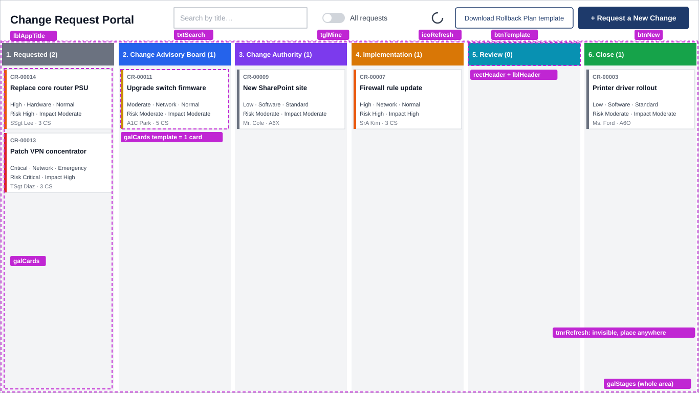
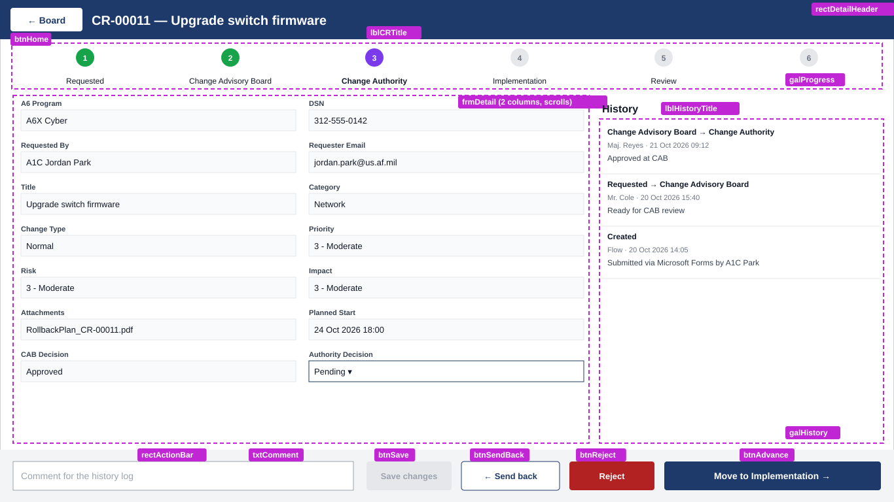

# Change Request Portal: Power Apps build guide

A canvas app that shows change requests as a board with one column per stage. Users submit new requests and move them through the stages:

| # | Stage | What happens | Rule before it can move on |
|---|-------|--------------|------------------|
| 1 | **Requested** | Requester submits the change | — |
| 2 | **Change Advisory Board** | CAB reviews risk and impact | `CABDecision` = Approved |
| 3 | **Change Authority** | Authority gives the final sign-off | `AuthorityDecision` = Approved |
| 4 | **Implementation** | Assignee carries out the change | Implementation notes filled in |
| 5 | **Review** | Post-implementation review | Review outcome chosen |
| 6 | **Close** | Done (or rejected) | — |

**Architecture:**
- **Data:** stored in two SharePoint lists, so no premium license is needed.
- **New requests:** come in through a Microsoft Form. A Power Automate flow turns each response into a list item.
- **Tracking:** the board and detail screen are a Power Apps canvas app.
- **Audit trail:** each stage change adds a row to a history list.

## Before you start

**Build order.** Total time is about 2–3 hours the first time.

| Step | What | Time |
|---|---|---|
| 1 | SharePoint lists | 20 min |
| 2 | Create the app and connect the lists | 10 min |
| 3 | BoardScreen | 45 min |
| 4 | Microsoft Form and Power Automate flow ([Change-Request-Form-Setup.md](Change-Request-Form-Setup.md)) | 40 min |
| 5 | DetailScreen | 60 min |
| 6 | Publish and share | 10 min |
| 7 | Test checklist | 20 min |
| 8 | Troubleshooting | as needed |

**Government clouds.** If your organization is on GCC High or DoD, the sites are at different addresses:

| Service | Commercial / GCC | GCC High |
|---|---|---|
| Power Apps | make.powerapps.com | make.high.powerapps.us |
| Power Automate | make.powerautomate.com | make.high.powerautomate.us |
| Forms | forms.office.com | forms.office365.us |

DoD tenants use different addresses again; ask your IT team for them. The easiest check is the address bar: wherever you already open Power Apps, use the same cloud for Forms and Power Automate. The top bar of Power Apps Studio shows your **Environment** (for example *United States Air Force*).

**How to set a property.** Every table in this guide uses this same routine:
1. Select the control in the **Tree view** on the left.
2. Choose the property in the dropdown at the left of the formula bar.
3. Type or paste the value into the formula bar, to the right of the **=**.

You can also type X, Y, Width and Height into the **Properties** pane on the right.

**Classic controls.** This guide uses the classic controls. If your **+ Insert** panel shows *Text label*, *Pen input* and *List box*, you're already using them. Their property names (`HintText`, `Fill`, `txtSearch.Text`, `tglMine.Value` and so on) match this guide.

**Quotes.** Type formulas directly or paste them from this guide. Don't paste through Word or Outlook. They turn straight quotes `"` into curly ones `“ ”`, which breaks formulas.

---

## Step 1 — Create the SharePoint lists

### Option A: script
Run [Provision-ChangeRequestLists.ps1](Provision-ChangeRequestLists.ps1) in PowerShell 7.4 or later:

```powershell
./Provision-ChangeRequestLists.ps1 -SiteUrl "https://<tenant>.sharepoint.com/sites/<site>" -ClientId "<your PnP Entra app id>"
```

PnP PowerShell needs its own Entra ID app registration, which usually needs an admin. If you don't have one, use Option B.

### Option B: by hand

**Change Requests list:**
1. On your SharePoint site, choose **+ New › List › Blank list**, name it **Change Requests**, and click **Create**.
2. For each row in the table below, click **+ Add column**, choose the type, then click **Next**.
3. Type the **Column** name *exactly* as shown, with no spaces. That becomes the internal name the formulas use, and you can't change it later. You can rename the *display* name afterwards.
4. For Choice columns, enter each choice on its own line, set the **Default value**, and under **More options** turn *Can add values manually* **off**.
5. For "Multiple lines" columns, open **More options** and turn **Use enhanced rich text** **off**.
6. Click **Save**.

| Column | Type | Choices / default |
|---|---|---|
| Title *(already exists)* | Single line | change title |
| Stage | Choice, **required** | Requested, Change Advisory Board, Change Authority, Implementation, Review, Close · default **Requested** |
| A6Program | Single line | |
| DSN | Single line | |
| RequestedBy | Single line | |
| RequesterEmail | Single line | |
| Category | Choice | Hardware, Software, Network · default *none* |
| ChangeType | Choice | Standard, Normal, Emergency, Informational · default *none* |
| Description | Multiple lines (plain) | |
| Priority | Choice | 4 - Low, 3 - Moderate, 2 - High, 1 - Critical · default *none* |
| Risk | Choice | 3 - Moderate, 2 - High, 1 - Critical · default *none* |
| Impact | Choice | 3 - Moderate, 2 - High, 1 - Critical · default *none* |
| FormResponseId | Number (0 decimals) | links the item back to its Forms response |
| PlannedStart | Date and time | |
| PlannedEnd | Date and time | |
| Assignee | Person | |
| CABDecision | Choice | Pending, Approved, Rejected · default **Pending** |
| CABNotes | Multiple lines (plain) | |
| AuthorityDecision | Choice | Pending, Approved, Rejected · default **Pending** |
| AuthorityNotes | Multiple lines (plain) | |
| ImplementationNotes | Multiple lines (plain) | |
| ActualStart | Date and time | |
| ActualEnd | Date and time | |
| ReviewOutcome | Choice | Successful, Successful with issues, Failed, Rolled back, Rejected · default *none* |
| ReviewNotes | Multiple lines (plain) | |
| ClosedDate | Date and time | |

Choice text must use a plain hyphen with a space on each side (`2 - High`). It has to match the Microsoft Form answers character for character.

The Rollback Plan PDF and any additional files are stored as **attachments** on the list item. Attachments are switched on by default.

**Change Request History list:**
1. Create a second blank list named **Change Request History**.
2. Add these four columns:

| Column | Type | Settings |
|---|---|---|
| RequestID | Number | More options › decimal places **0** |
| FromStage | Single line | |
| ToStage | Single line | |
| Comment | Multiple lines | More options › *Use enhanced rich text* **off** |

3. The built-in **Title** column can't be deleted. Rename its display name to **CR Number**: click the column header, then **Column settings › Rename**. The app writes `CR-00012` into it.

**Index the columns the app filters on.** This keeps the lists fast as they grow.
1. Open **Change Requests**, then **⚙ › List settings › Indexed columns › Create a new index**.
2. Set **Primary column** to **Stage** and click **Create**.
3. In **Change Request History**, do the same with **RequestID**.

**Upload the Rollback Plan template:**
1. Upload [Rollback-Plan-Template.pdf](Rollback-Plan-Template.pdf) to the site's **Documents** library. A folder named *Change Templates* is a good place for it.
2. Click **⋯ › Copy link** on the file. You'll paste that link into `RollbackTemplateUrl` in Step 2.

---

## Step 2 — Create the app

1. Go to **make.powerapps.com** (or your government address) and choose **+ Create › Blank app › Blank canvas app**. Name it **Change Request Portal**, pick the **Tablet** format, and click **Create**.
2. Click the **Data** icon (the cylinder) in the far-left bar, then **Add data**. Search for **SharePoint** and choose your site. Tick **both** lists and click **Connect**.
3. Click **Settings** (the gear in the toolbar). Under **General**, set **Data row limit** to `2000`, then close Settings.
4. Set up the screens:
   1. In the **Tree view**, double-click **Screen1** and rename it to `BoardScreen`.
   2. Choose **New screen › Blank** and rename the new screen to `DetailScreen`.

### App.Formulas (named formulas)
1. Click **App** at the top of the Tree view.
2. Choose **Formulas** in the property dropdown and paste the block below.
3. Replace the placeholder emails and links with your own.

```powerfx
Stages = Table(
    {Order: 1, Name: "Requested",             Color: ColorValue("#6B7280")},
    {Order: 2, Name: "Change Advisory Board", Color: ColorValue("#2563EB")},
    {Order: 3, Name: "Change Authority",      Color: ColorValue("#7C3AED")},
    {Order: 4, Name: "Implementation",        Color: ColorValue("#D97706")},
    {Order: 5, Name: "Review",                Color: ColorValue("#0891B2")},
    {Order: 6, Name: "Close",                 Color: ColorValue("#16A34A")}
);

// Who can record decisions. Use lower-case emails.
CABMembers        = ["cab.chair@contoso.com", "cab.member@contoso.com"];
ChangeAuthorities = ["change.manager@contoso.com"];

IsCAB       = Lower(User().Email) in CABMembers;
IsAuthority = Lower(User().Email) in ChangeAuthorities;

// Links used by the board buttons. See Change-Request-Form-Setup.md.
FormUrl             = "https://forms.office.com/r/REPLACE_ME";
RollbackTemplateUrl = "https://<tenant>.sharepoint.com/sites/<site>/Shared%20Documents/Change%20Templates/Rollback-Plan-Template.pdf";

PriorityColor(p: Text): Color =
    Switch(p, "1 - Critical", Color.Red, "2 - High", Color.DarkOrange, "3 - Moderate", Color.Goldenrod, Color.Gray);
```

**If you see errors:**
- **"Formulas" isn't in the dropdown:** go to **Settings › Updates** and turn on **Named formulas**.
- **Only the `PriorityColor` line is red:** turn on **User-defined functions** in **Settings › Updates**. Or delete those two lines and use the inline formula given for `rectPriority` in Step 3.

> To manage approvers without editing the app, you can replace the hard-coded email lists with an Entra security group (use the Office 365 Groups connector) or with a small "Approvers" SharePoint list.

**Optional:** set **App › StartScreen** to `BoardScreen`. The app opens on the first screen in the Tree view anyway.

---

## Step 3 — BoardScreen (the board)



*The magenta tags name each control. Dashed outlines show the galleries and templates.*

### 3.1 Screen property
Select **BoardScreen** and set **OnVisible**:
```powerfx
Refresh('Change Requests')
```

### 3.2 Header controls
Select **BoardScreen** in the Tree view before inserting each control. The positions assume the Tablet size (1366 × 768). Keep every header control above **Y = 80**, because that's where `galStages` starts.

| # | Insert | Rename to | Properties |
|---|---|---|---|
| 1 | Text label *(optional title)* | `lblAppTitle` | Text: `"Change Request Portal"` · Size: `20` · FontWeight: `FontWeight.Bold` · X `20` · Y `15` · Width `300` · Height `40` |
| 2 | Text input | `txtSearch` | Default: `""` · HintText: `"Search by title…"` *(grey placeholder shown while empty)* · X `340` · Y `15` · Width `260` · Height `40` |
| 3 | Toggle | `tglMine` | Default: `false` · TrueText: `"My requests"` · FalseText: `"All requests"` · X `620` · Y `15` · Width `200` · Height `40` |
| 4 | Icons › Reload | `icoRefresh` | OnSelect: `Refresh('Change Requests')` · X `840` · Y `20` · Width `30` · Height `30` |
| 5 | Button | `btnTemplate` | Text: `"Download Rollback Plan template"` · OnSelect: `Launch(RollbackTemplateUrl, {}, LaunchTarget.New)` · Fill: `Color.White` · Color: `ColorValue("#1E3A6B")` · BorderColor: `ColorValue("#1E3A6B")` · X `890` · Y `15` · Width `230` · Height `40` |
| 6 | Button | `btnNew` | Text: `"+ Request a New Change"` · OnSelect: `Launch(FormUrl, {}, LaunchTarget.New)` · Fill: `ColorValue("#1E3A6B")` · X `1130` · Y `13` · Width `216` · Height `44` |
| 7 | Timer | `tmrRefresh` | Duration: `60000` · Repeat: `true` · AutoStart: `true` · Visible: `false` · OnTimerEnd: `Refresh('Change Requests')` |

**Check:**
- Hold **Alt** and click **btnNew**. Your form should open in a new tab.
- Do the same with **btnTemplate**. It should open the PDF.

The search box and toggle start working once `galCards` (3.4) is built.

> New requests come in through the Microsoft Form, and a Power Automate flow creates the list item (Step 4). It takes a few seconds for a new request to appear. The timer refreshes the board every minute, and the refresh icon updates it immediately.

### 3.3 The stage columns: `galStages`
`galStages` is a horizontal gallery with one item per stage, so you get six columns. You design **one** column (the *template*), and Power Apps repeats it for each stage.

1. Select **BoardScreen**, then go to **+ Insert** and search for **Blank horizontal gallery**. Insert it.
2. If a **Select a data source** panel pops up, close it. You'll set Items by hand.
3. Rename it to `galStages` and set these properties:

| Property | Value |
|---|---|
| Items | `Stages` |
| X / Y | `0` / `80` |
| Width | `Parent.Width` |
| Height | `Parent.Height - 80` |
| TemplatePadding | `4` |
| TemplateSize | `Self.Width / 6 - 9` *(fits all six columns on screen)* |
| ShowScrollbar | `false` |
| ShowNavigation | `false` |

You should now see six empty columns.

**Add controls inside the template.**
1. Click once on the **first column** on the canvas. A small pencil icon ✎ appears at its top-left, which means the template is selected.
2. Anything you insert now goes into the template and repeats in all six columns.
3. In the Tree view, each new control should appear **indented under `galStages`**. If it appears at screen level instead, delete it, click the first column again, and re-insert.

Insert these in this order. Controls inserted earlier sit *behind* later ones.

| # | Insert | Rename to | Properties |
|---|---|---|---|
| 1 | Rectangle | `rectColumnBg` | X `0` · Y `0` · Width `Parent.TemplateWidth` · Height `Parent.TemplateHeight` · Fill: `RGBA(0,0,0,0.05)` |
| 2 | Rectangle | `rectHeader` | X `0` · Y `0` · Width `Parent.TemplateWidth` · Height `44` · Fill: `ThisItem.Color` |
| 3 | Text label | `lblHeader` | X `0` · Y `0` · Width `Parent.TemplateWidth` · Height `44` · Color: `Color.White` · FontWeight: `FontWeight.Semibold` · Size: `12` · PaddingLeft: `10` · Text: see below |

`lblHeader` **Text**:
```powerfx
ThisItem.Order & ". " & ThisItem.Name & "  (" & CountRows(galCards.AllItems) & ")"
```
> This line shows a red error ("galCards isn't recognized") until you finish 3.4. That's expected.

**Check:** you should see six coloured headers labelled *1. Requested* through *6. Close*.

### 3.4 The ticket cards: `galCards`
`galCards` is a vertical gallery **inside** each stage column. It lists the tickets in that stage.

1. Click the first column of `galStages` so the template is selected (pencil icon ✎).
2. Go to **+ Insert**, search for **Blank vertical gallery**, and insert it. Close the data-source panel if it appears.
3. Check that the new gallery is indented under `galStages` in the Tree view.
4. Rename it to `galCards` and set:

| Property | Value |
|---|---|
| X / Y | `4` / `52` |
| Width | `Parent.TemplateWidth - 8` |
| Height | `Parent.TemplateHeight - 56` |
| TemplateSize | `120` |
| TemplatePadding | `4` |
| OnSelect | `Set(varCR, ThisItem); Navigate(DetailScreen, ScreenTransition.Cover)` |

**Items.** In this property, `ThisItem` still means the *stage* from the outer gallery:
```powerfx
Sort(
    Filter(
        'Change Requests',
        Stage.Value = ThisItem.Name,
        !tglMine.Value || RequesterEmail = User().Email,
        IsBlank(txtSearch.Text) || StartsWith(Title, txtSearch.Text)
    ),
    Modified,
    SortOrder.Descending
)
```

**Add the card controls.**
1. Click inside `galCards` so *its* template is selected (pencil icon ✎ at its top-left).
2. Insert the controls below. Inside the card template, `ThisItem` means the *ticket*.

For every **Text label** in the card, set **PaddingTop** `0`, **PaddingBottom** `0` and **PaddingLeft** `0`. Otherwise the text is cut off in the short labels.

| # | Insert | Rename to | Properties |
|---|---|---|---|
| 1 | Rectangle | `rectCard` | X `0` · Y `0` · Width `Parent.TemplateWidth` · Height `Parent.TemplateHeight - 4` · Fill: `Color.White` · BorderColor: `RGBA(0,0,0,0.15)` · BorderThickness: `1` |
| 2 | Rectangle | `rectPriority` | X `0` · Y `0` · Width `5` · Height `Parent.TemplateHeight - 4` · Fill: `PriorityColor(ThisItem.Priority.Value)` |
| 3 | Text label | `lblId` | X `12` · Y `4` · Width `Parent.TemplateWidth - 16` · Height `18` · Size `9` · FontWeight: `FontWeight.Semibold` · Color: `RGBA(0,0,0,0.55)` · Text: `"CR-" & Text(ThisItem.ID, "00000")` |
| 4 | Text label | `lblTitle` | X `12` · Y `22` · Width `Parent.TemplateWidth - 16` · Height `36` · Size `11` · FontWeight: `FontWeight.Semibold` · VerticalAlign: `VerticalAlign.Top` · Text: `ThisItem.Title` |
| 5 | Text label | `lblMeta` | X `12` · Y `58` · Width `Parent.TemplateWidth - 16` · Height `18` · Size `9` · Text: `"P" & Left(ThisItem.Priority.Value, 1) & " · " & ThisItem.Category.Value & " · " & ThisItem.ChangeType.Value` |
| 6 | Text label | `lblRisk` | X `12` · Y `76` · Width `Parent.TemplateWidth - 16` · Height `18` · Size `9` · Text: `"Risk " & Left(ThisItem.Risk.Value, 1) & " · Impact " & Left(ThisItem.Impact.Value, 1)` |
| 7 | Text label | `lblOwner` | X `12` · Y `94` · Width `Parent.TemplateWidth - 16` · Height `18` · Size `9` · Color: `RGBA(0,0,0,0.55)` · Text: `ThisItem.RequestedBy & " · " & ThisItem.A6Program & " · " & Text(ThisItem.Created, "dd mmm yyyy")` |

If `PriorityColor` isn't available in your environment, use this as `rectPriority` **Fill** instead:
`Switch(ThisItem.Priority.Value, "1 - Critical", Color.Red, "2 - High", Color.DarkOrange, "3 - Moderate", Color.Goldenrod, Color.Gray)`

**Check:**
1. The red error on `lblHeader` should now be gone.
2. The board stays empty until a request exists. To see a card, either:
   - submit a test response once Step 4 is done, or
   - in SharePoint, open **Change Requests › + New** and add an item with a Title and Stage = *Requested*.
3. Click **icoRefresh** with **Alt** held. The card should appear in **1. Requested**, and the header should say **(1)**.
4. Press **F5** to preview. Typing in the search box should filter the cards, and the toggle should switch between all requests and yours.

> **Optional:** if the Close column gets too long, add `ClosedDate >= DateAdd(Today(), -30) || Stage.Value <> "Close"` as another condition in the Filter. That column then shows only changes closed in the last 30 days.

---

## Step 4 — New requests (Microsoft Form + Power Automate)

New change requests are submitted through a **Microsoft Form** rather than a screen in the app. The **+ Request a New Change** button on the board opens the form. When someone submits it, a Power Automate flow:
- creates the item in *Change Requests* with Stage = **Requested**,
- attaches the Rollback Plan PDF and any additional files to that item,
- and writes the first row to the history list.

Full setup is in **[Change-Request-Form-Setup.md](Change-Request-Form-Setup.md)**. When you've finished it, paste the form link into `FormUrl` in App.Formulas.

---

## Step 5 — DetailScreen (view, decide, move the request)



**Tip: load a real request while you build.** The DetailScreen shows whatever request is in `varCR`. While you're building it, `varCR` is empty, so the form looks blank. To fill it:
1. Make sure at least one request exists (see the 3.4 check).
2. Go to **BoardScreen** and press **F5**.
3. Click a card, then close the preview with **Esc** or the **X**.

`varCR` now holds that request, and the DetailScreen shows real data as you build it.

### 5.1 Screen property
Select **DetailScreen** and set **OnVisible**. This reloads the latest copy of the request:
```powerfx
Set(varCR, LookUp('Change Requests', ID = varCR.ID))
```

### 5.2 Header and progress tracker
Select **DetailScreen** in the Tree view, then insert:

| # | Insert | Rename to | Properties |
|---|---|---|---|
| 1 | Rectangle | `rectDetailHeader` | X `0` · Y `0` · Width `Parent.Width` · Height `60` · Fill: `ColorValue("#1E3A6B")` |
| 2 | Button | `btnHome` | Text: `"← Board"` · OnSelect: `Navigate(BoardScreen, ScreenTransition.UnCover)` · Fill: `Color.White` · Color: `ColorValue("#1E3A6B")` · X `16` · Y `12` · Width `110` · Height `36` |
| 3 | Text label | `lblCRTitle` | Text: `"CR-" & Text(varCR.ID, "00000") & " — " & varCR.Title` · Color: `Color.White` · Size `18` · FontWeight: `FontWeight.Bold` · X `140` · Y `10` · Width `Parent.Width - 160` · Height `40` |
| 4 | Blank horizontal gallery | `galProgress` | Items: `Stages` · X `20` · Y `66` · Width `Parent.Width - 40` · Height `70` · TemplateSize: `Self.Width / 6 - 1` · TemplatePadding `0` · ShowScrollbar `false` · ShowNavigation `false` |

Now click the first item of **galProgress** so its template is selected (pencil icon ✎), and insert:

| # | Insert | Rename to | Properties |
|---|---|---|---|
| 1 | Circle *(search "circle")* | `circStep` | X `(Parent.TemplateWidth - 28) / 2` · Y `4` · Width `28` · Height `28` · Fill: see below |
| 2 | Text label | `lblStepNum` | X `(Parent.TemplateWidth - 28) / 2` · Y `4` · Width `28` · Height `28` · Text: `ThisItem.Order` · Align: `Align.Center` · Size `10` · FontWeight: `FontWeight.Bold` · PaddingTop/Bottom/Left/Right `0` · Color: `If(ThisItem.Order <= LookUp(Stages, Name = varCR.Stage.Value).Order, Color.White, RGBA(0,0,0,0.55))` |
| 3 | Text label | `lblStepName` | X `0` · Y `38` · Width `Parent.TemplateWidth` · Height `24` · Text: `ThisItem.Name` · Align: `Align.Center` · Size `10` · FontWeight: `If(ThisItem.Name = varCR.Stage.Value, FontWeight.Bold, FontWeight.Normal)` |

`circStep` **Fill** (completed stages are green, the current stage is its own colour, and future stages are grey):
```powerfx
With({cur: LookUp(Stages, Name = varCR.Stage.Value).Order},
    If(ThisItem.Order < cur, ColorValue("#16A34A"),
       ThisItem.Order = cur, ThisItem.Color,
       RGBA(0,0,0,0.12)))
```

### 5.3 The request form: `frmDetail`
1. Select **DetailScreen**, go to **+ Insert**, and choose **Edit form**. Rename it to `frmDetail`.
2. Set these properties:

| Property | Value |
|---|---|
| DataSource | `'Change Requests'` |
| Item | `varCR` |
| DefaultMode | `FormMode.Edit` |
| X / Y | `20` / `146` |
| Width / Height | `880` / `Parent.Height - 236` |
| Columns *(Properties pane)* | `2` |

**Choose the fields.**
1. With `frmDetail` selected, go to the **Properties** pane on the right and click **Edit fields**.
2. Remove any field that isn't in the list below: hover it, click **⋯**, then **Remove**. In particular, remove **Stage**, **ClosedDate**, **FormResponseId**, **Created** and **Modified**. The buttons control the stage, so a save can never overwrite it.
3. Click **+ Add field**, tick the missing ones, and click **Add**.
4. Drag the fields into this order:

> A6Program · RequestedBy · DSN · RequesterEmail · Title · Category · ChangeType · Priority · Risk · Impact · Description · PlannedStart · PlannedEnd · **Attachments** · CABDecision · CABNotes · AuthorityDecision · AuthorityNotes · Assignee · ActualStart · ActualEnd · ImplementationNotes · ReviewOutcome · ReviewNotes

**Unlock the cards so you can change them.** Each field is a *card*, and cards are locked by default.
1. In the Tree view, expand `frmDetail` and click a card (e.g. `CABDecision_DataCard1`).
2. In the **Properties** pane, open the **Advanced** tab.
3. Click **🔒 Unlock to change properties**.

Do this for every card in the table below.

> **Shortcut:** once the cards in a row of the table are unlocked, you can set them together. **Ctrl+click** them in the Tree view, then set Visible and DisplayMode once for all of them.

**Set each card's Visible and DisplayMode** so it only appears from its stage onward, and can only be edited during its own stage:

| Cards | Visible | DisplayMode |
|---|---|---|
| A6Program, RequestedBy, DSN, RequesterEmail, Title, Category, ChangeType, Priority, Risk, Impact, Description, PlannedStart, PlannedEnd | `true` | `If(varCR.Stage.Value = "Requested", DisplayMode.Edit, DisplayMode.View)` |
| Attachments | `true` | `If(varCR.Stage.Value = "Close", DisplayMode.View, DisplayMode.Edit)` |
| CABDecision, CABNotes | `LookUp(Stages, Name = varCR.Stage.Value).Order >= 2` | `If(varCR.Stage.Value = "Change Advisory Board" && IsCAB, DisplayMode.Edit, DisplayMode.View)` |
| AuthorityDecision, AuthorityNotes | `LookUp(Stages, Name = varCR.Stage.Value).Order >= 3` | `If(varCR.Stage.Value = "Change Authority" && IsAuthority, DisplayMode.Edit, DisplayMode.View)` |
| Assignee, ActualStart, ActualEnd, ImplementationNotes | `LookUp(Stages, Name = varCR.Stage.Value).Order >= 4` | `If(varCR.Stage.Value = "Implementation", DisplayMode.Edit, DisplayMode.View)` |
| ReviewOutcome, ReviewNotes | `LookUp(Stages, Name = varCR.Stage.Value).Order >= 5` | `If(varCR.Stage.Value = "Review", DisplayMode.Edit, DisplayMode.View)` |

**frmDetail.OnSuccess**
```powerfx
Set(varCR, Self.LastSubmit);
Notify("Saved", NotificationType.Success)
```

**frmDetail.OnFailure**
```powerfx
Notify("Couldn't save: " & Self.Error, NotificationType.Error)
```

**Check:** with a request loaded (see the tip at the top of Step 5), a request in *Requested* should show only the request fields and Attachments, and they should be editable. Click the Rollback Plan attachment to open the PDF.

### 5.4 History panel
Select **DetailScreen**, then insert:

| # | Insert | Rename to | Properties |
|---|---|---|---|
| 1 | Text label | `lblHistoryTitle` | Text: `"History"` · Size `14` · FontWeight: `FontWeight.Bold` · X `920` · Y `146` · Width `426` · Height `32` |
| 2 | Blank vertical gallery | `galHistory` | X `920` · Y `182` · Width `426` · Height `Parent.Height - 272` · TemplateSize `80` · TemplatePadding `0` · Items: see below |

`galHistory` **Items**:
```powerfx
Sort(Filter('Change Request History', RequestID = varCR.ID), Created, SortOrder.Descending)
```

Click the first item of **galHistory** so its template is selected (pencil icon ✎), and insert the controls below. Set every label's **PaddingTop/Bottom/Left** to `0`.

| # | Insert | Rename to | Properties |
|---|---|---|---|
| 1 | Text label | `lblHistMove` | X `8` · Y `6` · Width `Parent.TemplateWidth - 16` · Height `22` · Size `10` · FontWeight: `FontWeight.Bold` · Text: `If(IsBlank(ThisItem.FromStage), "Created", ThisItem.FromStage & " → " & ThisItem.ToStage)` |
| 2 | Text label | `lblHistWho` | X `8` · Y `28` · Width `Parent.TemplateWidth - 16` · Height `18` · Size `9` · Color: `RGBA(0,0,0,0.55)` · Text: `ThisItem.Author.DisplayName & " · " & Text(ThisItem.Created, "dd mmm yyyy hh:mm")` |
| 3 | Text label | `lblHistComment` | X `8` · Y `48` · Width `Parent.TemplateWidth - 16` · Height `28` · Size `10` · Text: `ThisItem.Comment` |
| 4 | Rectangle | `rectHistLine` | X `0` · Y `Parent.TemplateHeight - 1` · Width `Parent.TemplateWidth` · Height `1` · Fill: `RGBA(0,0,0,0.1)` |

### 5.5 Action bar
Select **DetailScreen**, then insert these controls. They all sit along the bottom of the screen.

| # | Insert | Rename to | Properties |
|---|---|---|---|
| 1 | Rectangle | `rectActionBar` | X `0` · Y `Parent.Height - 80` · Width `Parent.Width` · Height `80` · Fill: `RGBA(0,0,0,0.05)` |
| 2 | Text input | `txtComment` | Default: `""` · HintText: `"Comment for the history log"` · X `20` · Y `Parent.Height - 62` · Width `520` · Height `44` |
| 3 | Button | `btnSave` | Text: `"Save changes"` · X `560` · Y `Parent.Height - 62` · Width `130` · Height `44` · OnSelect / DisplayMode below |
| 4 | Button | `btnSendBack` | Text: `"← Send back"` · Fill: `Color.White` · Color: `ColorValue("#1E3A6B")` · BorderColor: `ColorValue("#1E3A6B")` · X `705` · Y `Parent.Height - 62` · Width `150` · Height `44` · Visible / DisplayMode / OnSelect below |
| 5 | Button | `btnReject` | Text: `"Reject"` · Fill: `Color.Firebrick` · X `870` · Y `Parent.Height - 62` · Width `130` · Height `44` · Visible / DisplayMode / OnSelect below |
| 6 | Button | `btnAdvance` | Fill: `ColorValue("#1E3A6B")` · X `1015` · Y `Parent.Height - 62` · Width `331` · Height `44` · Text / Visible / DisplayMode / OnSelect below |

If `rectActionBar` covers the other controls, right-click it and choose **Reorder › Send to back**.

**`btnSave`**
- OnSelect: `SubmitForm(frmDetail)`
- DisplayMode: `If(frmDetail.Unsaved, DisplayMode.Edit, DisplayMode.Disabled)`

**`btnAdvance`**
- Visible: `varCR.Stage.Value <> "Close"`
- DisplayMode: `If(frmDetail.Unsaved, DisplayMode.Disabled, DisplayMode.Edit)`. This forces users to save before moving a request, so the checks below always look at saved data.
- Text:
  ```powerfx
  "Move to " & LookUp(Stages, Order = LookUp(Stages, Name = varCR.Stage.Value).Order + 1).Name & " →"
  ```
- OnSelect:
  ```powerfx
  With({cur: LookUp(Stages, Name = varCR.Stage.Value)},
  With({nxt: LookUp(Stages, Order = cur.Order + 1)},
      If(
          cur.Name = "Change Advisory Board" && varCR.CABDecision.Value <> "Approved",
              Notify("The CAB decision must be Approved before this change can move on.", NotificationType.Error),
          cur.Name = "Change Authority" && varCR.AuthorityDecision.Value <> "Approved",
              Notify("The Change Authority decision must be Approved before this change can move on.", NotificationType.Error),
          cur.Name = "Implementation" && IsBlank(varCR.ImplementationNotes),
              Notify("Add implementation notes before moving to Review.", NotificationType.Error),
          cur.Name = "Review" && IsBlank(varCR.ReviewOutcome.Value),
              Notify("Choose a review outcome before closing.", NotificationType.Error),

          // all checks passed
          Set(varCR, Patch('Change Requests', varCR, {
              Stage:      {Value: nxt.Name},
              ClosedDate: If(nxt.Name = "Close", Now())
          }));
          Patch('Change Request History', Defaults('Change Request History'), {
              Title:     "CR-" & Text(varCR.ID, "00000"),
              RequestID: varCR.ID,
              FromStage: cur.Name,
              ToStage:   nxt.Name,
              Comment:   txtComment.Text
          });
          Reset(txtComment);
          Notify("Moved to " & nxt.Name, NotificationType.Success)
      )
  ))
  ```

**`btnSendBack`**: returns the request to the previous stage. A comment is required.
- Visible: `With({o: LookUp(Stages, Name = varCR.Stage.Value).Order}, o >= 2 && o <= 5)`
- DisplayMode: `If(frmDetail.Unsaved, DisplayMode.Disabled, DisplayMode.Edit)`
- OnSelect:
  ```powerfx
  If(IsBlank(txtComment.Text),
      Notify("Add a comment explaining why it's being sent back.", NotificationType.Warning),
      With({cur: LookUp(Stages, Name = varCR.Stage.Value)},
      With({prv: LookUp(Stages, Order = cur.Order - 1)},
          Set(varCR, Patch('Change Requests', varCR, {Stage: {Value: prv.Name}}));
          Patch('Change Request History', Defaults('Change Request History'), {
              Title:     "CR-" & Text(varCR.ID, "00000"),
              RequestID: varCR.ID,
              FromStage: cur.Name,
              ToStage:   prv.Name,
              Comment:   txtComment.Text
          });
          Reset(txtComment);
          Notify("Sent back to " & prv.Name, NotificationType.Warning)
      ))
  )
  ```

**`btnReject`**: lets approvers reject the request, which moves it straight to Close.
- Visible: `(varCR.Stage.Value = "Change Advisory Board" && IsCAB) || (varCR.Stage.Value = "Change Authority" && IsAuthority)`
- DisplayMode: `If(frmDetail.Unsaved, DisplayMode.Disabled, DisplayMode.Edit)`
- OnSelect:
  ```powerfx
  If(IsBlank(txtComment.Text),
      Notify("Add a comment explaining the rejection.", NotificationType.Warning),
      With({prevStage: varCR.Stage.Value},
          If(prevStage = "Change Advisory Board",
              Set(varCR, Patch('Change Requests', varCR, {
                  Stage: {Value: "Close"}, ReviewOutcome: {Value: "Rejected"}, ClosedDate: Now(),
                  CABDecision: {Value: "Rejected"}, CABNotes: txtComment.Text
              })),
              Set(varCR, Patch('Change Requests', varCR, {
                  Stage: {Value: "Close"}, ReviewOutcome: {Value: "Rejected"}, ClosedDate: Now(),
                  AuthorityDecision: {Value: "Rejected"}, AuthorityNotes: txtComment.Text
              }))
          );
          Patch('Change Request History', Defaults('Change Request History'), {
              Title:     "CR-" & Text(varCR.ID, "00000"),
              RequestID: varCR.ID,
              FromStage: prevStage,
              ToStage:   "Close",
              Comment:   "REJECTED: " & txtComment.Text
          });
          Reset(txtComment);
          Notify("Change rejected and closed", NotificationType.Warning)
      )
  )
  ```

**Check:** press **F5** on BoardScreen, click a card, and confirm that:
- the progress tracker highlights stage 1,
- the **Move to Change Advisory Board →** button shows,
- *Save changes* is greyed out until you edit a field.

---

## Step 6 — Publish and share

1. **Save:** press **Ctrl+S**, or use the save icon at the top right.
2. **Publish:** click **Publish**, then **Publish this version**. Users only see published versions.
3. **Share the app:**
   1. Go to **make.powerapps.com › Apps**.
   2. Click **⋯** next to *Change Request Portal*, then **Share**.
   3. Add users or a security group and click **Share**.
4. **Give SharePoint access:**
   1. On the SharePoint site, go to **⚙ › Site permissions** (or **Share site**).
   2. Add the same people with **Edit** permission.

   The app reads and writes the lists using each user's own permissions, so without this they'll see errors.
5. **First launch:** the first time each user opens the app, they're asked to **Allow** the SharePoint connection. That's expected.

---

## Step 7 — Test checklist

Work through this list in the **published** app. Test with your own account and, for the last item, with someone who isn't an approver.

| # | Do this | Expect |
|---|---|---|
| 1 | Click **+ Request a New Change**, fill the form, upload the Rollback Plan PDF, and submit | Form confirms submission |
| 2 | Open the flow's **Run history** in Power Automate | Latest run is green on every step |
| 3 | Open the **Change Requests** list in SharePoint | New item with Stage = Requested, CAB/Authority = Pending, attachment `RollbackPlan_CR-000NN.pdf` |
| 4 | Back in the app, click the refresh icon | Card appears in **1. Requested**, header count is (1) |
| 5 | Type part of the title in the search box, then turn on the toggle | Card stays (title match, your email) |
| 6 | Click the card | Detail screen opens; stage 1 is highlighted; request fields are editable; the PDF opens from Attachments |
| 7 | Edit a field, then try to click **Move** | Move is disabled until you click **Save changes** |
| 8 | Save, type a comment, and click **Move to Change Advisory Board** | Moves to stage 2; a History row appears with your comment |
| 9 | Click **Move** again without approving | Error: *CAB decision must be Approved* |
| 10 | As a CAB member, set CAB Decision = Approved, Save, then Move | Moves to Change Authority |
| 11 | Click **Send back** with no comment, then with a comment | First: warning. Second: returns to CAB with a History row |
| 12 | Move forward again. As an Authority, set Approved, Save, then Move | Moves to Implementation |
| 13 | Click **Move** with Implementation Notes empty, then fill them, Save and Move | First: error. Then it moves to Review |
| 14 | Choose a Review Outcome, Save, then Move | Moves to Close; ClosedDate is set; every field is read-only; the Move button is hidden |
| 15 | Submit a second request, move it to CAB, enter a comment, and click **Reject** | Goes straight to Close with outcome *Rejected* |
| 16 | Ask someone who **isn't** in `CABMembers` to open a CAB-stage request | Decision fields are read-only and there's no Reject button |

---

## Step 8 — Troubleshooting

| Symptom | Likely cause | Fix |
|---|---|---|
| `'Change Requests'` is underlined red: *Name isn't valid* | List not connected, or named differently | **Data › Add data** and connect it, or make the names in the formulas match your list name |
| A column name like `RequesterEmail` is red | The column was created with a space, so its internal name is different (e.g. `Requester_x0020_Email`) | In SharePoint **List settings**, click the column and look at the end of the browser URL (`Field=…`) for its real internal name. Either recreate the column without a space or use that name in the formulas |
| `lblHeader` shows *galCards isn't recognized* | `galCards` not built yet or named differently | Finish 3.4 and check the gallery is named exactly `galCards` |
| Blue underline or yellow triangle: *delegation warning* | The Filter can't be fully run by SharePoint | Safe up to 2,000 items per stage. Make sure **Data row limit** is `2000` (Step 2) |
| Card text is cut off | Label padding or height | Set PaddingTop/Bottom to `0` (3.4), or increase the label Height and TemplateSize |
| Priority, Risk or Category is blank on cards | Form answer text doesn't match the SharePoint choice text | Make the choices identical, with a plain hyphen and spaces (`2 - High`). Fix existing items in the list |
| New request never appears on the board | Flow failed, or Stage isn't exactly `Requested` | Check the flow's **Run history**. Check the item's Stage in SharePoint |
| Flow fails at **Parse JSON** | The Additional attachments answer was empty | Use the `if(empty(...), '[]', ...)` guard from the form setup document (Part C, step 6) |
| Flow fails at **Get file content** | The flow isn't running as the form owner | Rebuild the flow signed in as the account that owns the form |
| CAB member can't edit the decision | Email in `CABMembers` doesn't match the sign-in email exactly. Air Force accounts can differ, e.g. `@us.af.mil` vs `@af.mil` | Add a temporary label with Text `User().Email`, check what it shows for that person, and put that exact address (lower case) in App.Formulas |
| Move, Send back and Reject are greyed out | There are unsaved edits on the form | Click **Save changes** first |
| *"Title" field is required* when moving a request | The History list's Title is required and a Patch didn't set it | All formulas in this guide set Title. Check that you copied the full Patch, or make Title optional in the History list settings |
| DetailScreen is blank while building | `varCR` is empty in Studio | Preview the board, click a card, and close the preview (see the tip in Step 5) |
| Users get access errors | They have the app but not the SharePoint site | Give them **Edit** on the site (Step 6) |
| Red errors after pasting a formula | Curly quotes from Word or Outlook | Retype the quotes as straight `"` |

---

## Optional extras

- **Email or Teams notifications:** create a Power Automate flow with the trigger *When an item is created or modified* on Change Requests, plus a condition on `Stage`. For example, when Stage = *Change Advisory Board*, post an adaptive card to the CAB Teams channel.
- **Stricter enforcement:** the stage rules are enforced only inside the app, and anyone with Edit permission could still change the list directly in SharePoint. If you need rules that can't be bypassed, move stage changes into a Power Automate flow that runs under a service account and make the list read-only for users, or move the data to Dataverse and use security roles.
- **Calendar view:** add a SharePoint calendar view on `PlannedStart`/`PlannedEnd` to get a forward schedule of changes.
- **Layout diagrams:** the images in this guide are generated by [docs/Build-Mockups.ps1](docs/Build-Mockups.ps1). Re-run it if you change the layout.
