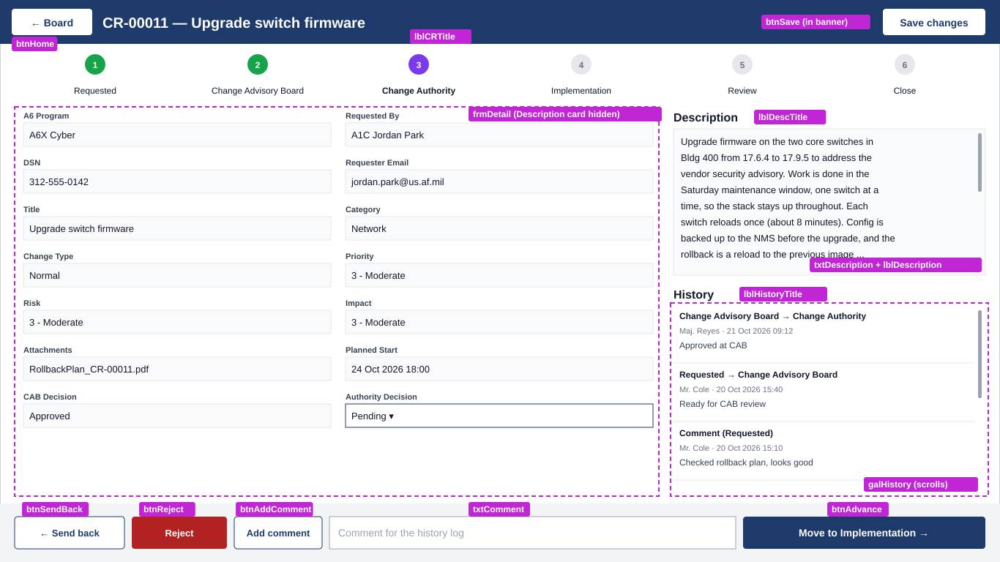

# DetailScreen updates: new layout and the Add comment button

These are changes to the **DetailScreen** you built in Step 5 of [Change-Request-PowerApp-Guide.md](Change-Request-PowerApp-Guide.md). They assume the buttons already **save first, then act**: `btnSave` runs `Set(varAction, "save"); SubmitForm(frmDetail)` and the action logic lives in `frmDetail.OnSuccess`.

What changes:
1. **Save changes** moves into the top-right corner of the blue banner.
2. **Description** moves out of the form to the right side of the screen, in its own scrollable box.
3. **History** moves down, below Description, and scrolls.
4. A new **Add comment** button posts a comment to the History without moving the request.
5. The **comment box** moves directly to the left of the **Move** button.



*The magenta tags name each control.*

> **How to set a property:** select the control in the **Tree view**, choose the property in the dropdown at the left of the formula bar, and paste the value into the formula bar. You can also type X, Y, Width and Height into the **Properties** pane on the right.

---

## 1 — Move Save changes into the banner

1. Select `btnSave` and set:

| Property | Value |
|---|---|
| X / Y | `Parent.Width - 160` / `12` |
| Width / Height | `140` / `36` |
| Fill | `Color.White` |
| Color | `ColorValue("#1E3A6B")` |

2. If the button disappears behind the blue banner, right-click it and choose **Reorder › Bring to front**.
3. Select `lblCRTitle` and change **Width** to `Parent.Width - 320`, so a long title doesn't run under the button.

`btnSave` **OnSelect** stays as it is.

---

## 2 — Description on the right, scrollable

The Description stays **in the form**, so Save still writes it to SharePoint, but its card is hidden. Two new controls on the right show it:
- **`txtDescription`**, an editable box, shown while the request is in *Requested*.
- **`lblDescription`**, a read-only box, shown at every later stage.

Both scroll when the text is longer than the box.

### 2a. Hide the Description card
1. In the Tree view, expand `frmDetail` and select `Description_DataCard1`. It's already unlocked from Step 5.3. If not, open **Properties › Advanced** and click **🔒 Unlock to change properties**.
2. Set **Visible** to `false`.
3. Set **Update** to:
   ```powerfx
   If(varCR.Stage.Value = "Requested", txtDescription.Text, Parent.Default)
   ```
   This line shows a red error until you add `txtDescription` in 2c. That's expected.

### 2b. Add the title
Select **DetailScreen** and insert a **Text label**. Rename it `lblDescTitle` and set:

| Property | Value |
|---|---|
| Text | `"Description"` |
| Size | `14` |
| FontWeight | `FontWeight.Bold` |
| X / Y | `920` / `146` |
| Width / Height | `426` / `28` |

### 2c. Add the editable box (Requested stage)
Insert a **Text input**. Rename it `txtDescription` and set:

| Property | Value |
|---|---|
| Mode | `TextMode.MultiLine` |
| Default | `varCR.Description` |
| HintText | `"Describe the change"` |
| Visible | `varCR.Stage.Value = "Requested"` |
| X / Y | `920` / `176` |
| Width / Height | `426` / `200` |

A multi-line text input shows a scroll bar on its own once the text is longer than the box.

### 2d. Add the read-only box (all later stages)
Insert a **Text label**. Rename it `lblDescription` and set:

| Property | Value |
|---|---|
| Text | `varCR.Description` |
| Overflow | `Overflow.Scroll` *(this makes it scrollable)* |
| VerticalAlign | `VerticalAlign.Top` |
| Visible | `varCR.Stage.Value <> "Requested"` |
| X / Y | `920` / `176` |
| Width / Height | `426` / `200` |
| Fill | `RGBA(0,0,0,0.02)` |
| BorderColor / BorderThickness | `RGBA(0,0,0,0.15)` / `1` |
| PaddingTop / Bottom / Left / Right | `8` |

Both boxes sit in the same spot, and only one is visible at a time.

---

## 3 — Move History down and make it scroll

Select each control and set:

| Control | Property | Value |
|---|---|---|
| `lblHistoryTitle` | X / Y | `920` / `388` |
| | Width / Height | `426` / `28` |
| `galHistory` | X / Y | `920` / `418` |
| | Width / Height | `426` / `Parent.Height - 508` |
| | ShowScrollbar | `true` |

The gallery scrolls on its own when there are more entries than fit, with the mouse wheel, the scroll bar or touch. `ShowScrollbar` makes the bar visible so users know there's more.

---

## 4 — Add comment button

### 4a. Add the button
Select **DetailScreen**, insert a **Button**, rename it `btnAddComment`, and set:

| Property | Value |
|---|---|
| Text | `"Add comment"` |
| Fill | `Color.White` |
| Color | `ColorValue("#1E3A6B")` |
| BorderColor | `ColorValue("#1E3A6B")` |
| Width / Height | `120` / `44` |

Its position is set in section 5.

**OnSelect**:
```powerfx
If(IsBlank(Trim(txtComment.Text)),
    Notify("Type a comment first.", NotificationType.Warning),
    Patch('Change Request History', Defaults('Change Request History'), {
        Title:     "CR-" & Text(varCR.ID, "00000"),
        RequestID: varCR.ID,
        FromStage: varCR.Stage.Value,
        ToStage:   varCR.Stage.Value,
        Comment:   txtComment.Text
    });
    Reset(txtComment);
    Notify("Comment added", NotificationType.Success)
)
```

The button doesn't touch the form, so it works at any stage, even with unsaved edits.

### 4b. Label comments in the History panel
A comment is saved with the *same* stage in FromStage and ToStage. Update the History label so those rows read **Comment (stage)** instead of showing an arrow.

Select `lblHistMove` (inside `galHistory`) and replace its **Text** with:
```powerfx
If(IsBlank(ThisItem.FromStage), "Created",
   ThisItem.FromStage = ThisItem.ToStage, "Comment (" & ThisItem.ToStage & ")",
   ThisItem.FromStage & " → " & ThisItem.ToStage)
```

---

## 5 — Rearrange the action bar

The comment box now sits directly to the left of the Move button. Every control in the bar uses **Y** = `Parent.Height - 62` and **Height** = `44`. Set X and Width:

| Control | X | Width |
|---|---|---|
| `btnSendBack` | `20` | `150` |
| `btnReject` | `180` | `130` |
| `btnAddComment` | `320` | `120` |
| `txtComment` | `450` | `555` |
| `btnAdvance` | `1015` | `331` |

`btnSave` is no longer in the bar. It's in the banner (section 1).

`btnReject` is only visible to approvers at the CAB and Change Authority stages. When it's hidden, there's a gap between Send back and Add comment. That's expected.

---

## Full position reference

Every control whose position changes in this update, in one place:

| Control | X | Y | Width | Height |
|---|---|---|---|---|
| `lblCRTitle` | `140` | `10` | `Parent.Width - 320` | `40` |
| `btnSave` | `Parent.Width - 160` | `12` | `140` | `36` |
| `lblDescTitle` | `920` | `146` | `426` | `28` |
| `txtDescription` | `920` | `176` | `426` | `200` |
| `lblDescription` | `920` | `176` | `426` | `200` |
| `lblHistoryTitle` | `920` | `388` | `426` | `28` |
| `galHistory` | `920` | `418` | `426` | `Parent.Height - 508` |
| `btnSendBack` | `20` | `Parent.Height - 62` | `150` | `44` |
| `btnReject` | `180` | `Parent.Height - 62` | `130` | `44` |
| `btnAddComment` | `320` | `Parent.Height - 62` | `120` | `44` |
| `txtComment` | `450` | `Parent.Height - 62` | `555` | `44` |
| `btnAdvance` | `1015` | `Parent.Height - 62` | `331` | `44` |

---

## Test

Press **F5** on **BoardScreen**, open a request, and check each row:

| # | Do this | Expect |
|---|---|---|
| 1 | Look at the banner | **Save changes** is in the top-right corner, and the title doesn't run under it |
| 2 | Open a request in **Requested** with a long description | Description is on the right, editable, and scrolls; the form on the left has no Description field |
| 3 | Change the description and click **Save changes** | "Saved"; close and reopen the request, and the new text is still there |
| 4 | Open a request at a later stage | Description shows read-only and still scrolls |
| 5 | Open a request with more than three History entries | History is below Description and scrolls to show older entries |
| 6 | Type a comment and click **Add comment** | History shows **Comment (current stage)** at the top; the stage doesn't change |
| 7 | Click **Add comment** with an empty box | Warning *Type a comment first*; nothing is added |
| 8 | Look at the action bar | The comment box sits directly left of the **Move** button |

**If something goes wrong:**
- **A red error banner** appears: send the exact text.
- **A control shows a red error:** check that its formula has no red underlines, and open the **App checker** (the stethoscope icon in the top toolbar) to see every error in the app.
- **Description edits aren't saved:** check that the `Description_DataCard1` **Update** formula from 2a is in place.
