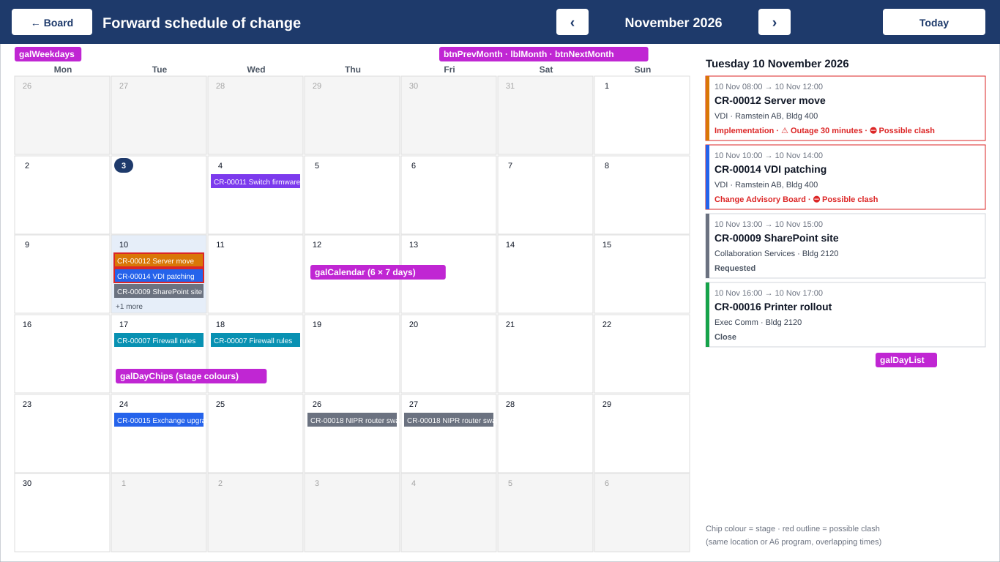

# Forward Schedule of Change (calendar)

A new **Schedule** screen shows every change with planned dates on a month calendar. It's the view a CAB typically reviews to see what's coming up and spot clashes.



*Mock-up. The magenta tags name the main controls.*

**What it does:**
- **Month grid:** each day lists the changes planned for it as coloured chips. A chip's colour is the request's **stage**, the same colours as the board columns. Days with more than three changes show *"+N more"*.
- **Conflicts:** a chip gets a **red outline** when it overlaps in time with another change at the **same location** or for the **same A6 program**.
- **Day panel:** click a day to list its changes on the right, with times, program, location, stage, an outage warning and a conflict warning. Click a change to open it.
- **Navigation:** **‹ ›** move between months and **Today** jumps back to now. **Schedule** on the board opens the calendar, and **← Schedule** on the detail screen comes back to it.
- **Who sees what:** the same rule as the board. CM, CAB and Authority see every change, and everyone else sees only their own.

**Before you start:** do **Parts 1–3 and 6** of the current updates document ([DetailScreen-Fixes.md](DetailScreen-Fixes.md)) first. This screen uses:
- the **Location** and **Outage** fields,
- the gap kept in the board header for the Schedule button.

> **How to set a property:** select the control in the **Tree view**, choose the property in the dropdown at the left of the formula bar, and paste the value into the formula bar. You can also type X, Y, Width and Height into the **Properties** pane on the right.

> **Inside a gallery:** to put a control inside a gallery, click the gallery's **first item** until the pencil ✎ shows at its top-left, then insert. In the Tree view, the control must be **indented under** that gallery.

**Time:** about 2 hours.

---

## 1 — Create the screen and its banner

1. Choose **New screen › Blank** and rename it `CalendarScreen`.
2. With **CalendarScreen** selected, insert:

| # | Insert | Rename to | Properties |
|---|---|---|---|
| 1 | Rectangle | `rectCalHeader` | X `0` · Y `0` · Width `Parent.Width` · Height `60` · Fill: `ColorValue("#1E3A6B")` |
| 2 | Button | `btnCalBack` | Text: `"← Board"` · OnSelect: `Navigate(BoardScreen, ScreenTransition.UnCover)` · Fill: `Color.White` · Color: `ColorValue("#1E3A6B")` · X `16` · Y `12` · Width `110` · Height `36` |
| 3 | Text label | `lblCalTitle` | Text: `"Forward schedule of change"` · Color: `Color.White` · Size `18` · FontWeight: `FontWeight.Bold` · X `140` · Y `10` · Width `420` · Height `40` |
| 4 | Button | `btnPrevMonth` | Text: `"‹"` · Size `18` · X `760` · Y `12` · Width `44` · Height `36` · OnSelect: see 2 |
| 5 | Text label | `lblMonth` | Text: `Text(varCalMonth, "mmmm yyyy")` · Color: `Color.White` · Size `16` · FontWeight: `FontWeight.Bold` · Align: `Align.Center` · X `810` · Y `10` · Width `220` · Height `40` |
| 6 | Button | `btnNextMonth` | Text: `"›"` · Size `18` · X `1036` · Y `12` · Width `44` · Height `36` · OnSelect: see 2 |
| 7 | Button | `btnToday` | Text: `"Today"` · Fill: `Color.White` · Color: `ColorValue("#1E3A6B")` · X `1206` · Y `12` · Width `140` · Height `36` · OnSelect: see 2 |

For `btnPrevMonth` and `btnNextMonth`, set **Fill** = `Color.White` and **Color** = `ColorValue("#1E3A6B")` as well.

---

## 2 — Load the month's changes

All the loading happens in one hidden button. The screen and the month buttons "press" it with `Select()`, so the logic is written once.

### 2a. The hidden loader button
Insert a **Button** on CalendarScreen. Rename it `btnCalLoad` and set **Visible** to `false`. Then set **OnSelect** to:

```powerfx
// First Monday shown on the grid (the grid always shows 6 weeks)
Set(varCalStart, DateAdd(varCalMonth, 1 - Weekday(varCalMonth, StartOfWeek.Monday), TimeUnit.Days));

// Changes whose planned start falls in or near the grid, for the people allowed to see them
ClearCollect(colCalRaw,
    AddColumns(
        Filter('Change Requests',
            PlannedStart >= DateAdd(varCalStart, -30, TimeUnit.Days),
            PlannedStart <  DateAdd(varCalStart, 42, TimeUnit.Days),
            CanSeeAll || SubmittedBy = User().Email || RequesterEmail = User().Email
        ),
        EndAt, Coalesce(PlannedEnd, PlannedStart)
    )
);

// Drop rejected changes, and flag overlaps at the same location or for the same A6 program
ClearCollect(colCal,
    AddColumns(
        Filter(colCalRaw, ReviewOutcome.Value <> "Rejected") As c,
        HasConflict,
        !IsEmpty(
            Filter(colCalRaw As o,
                o.ID <> c.ID,
                o.ReviewOutcome.Value <> "Rejected",
                o.PlannedStart < c.EndAt,
                o.EndAt > c.PlannedStart,
                (!IsBlank(c.Location) && o.Location = c.Location) ||
                (!IsBlank(c.A6Program) && o.A6Program = c.A6Program)
            )
        )
    )
)
```

How it works:
- **`EndAt`:** the planned end, or the planned start if no end was entered.
- **`colCal`:** the collection every part of the screen reads from.
- **`HasConflict`:** `true` when another change overlaps in time at the same location or for the same A6 program.

> To check only **location** clashes, delete the line with `A6Program`, plus the `||` at the end of the line before it.

### 2b. Wire up the screen and the month buttons

| Control | Property | Value |
|---|---|---|
| **CalendarScreen** | OnVisible | see below |
| `btnPrevMonth` | OnSelect | `Set(varCalMonth, DateAdd(varCalMonth, -1, TimeUnit.Months)); Select(btnCalLoad)` |
| `btnNextMonth` | OnSelect | `Set(varCalMonth, DateAdd(varCalMonth, 1, TimeUnit.Months)); Select(btnCalLoad)` |
| `btnToday` | OnSelect | `Set(varCalMonth, Date(Year(Today()), Month(Today()), 1)); Set(varCalDay, Today()); Select(btnCalLoad)` |

**CalendarScreen › OnVisible:**
```powerfx
If(IsBlank(varCalMonth), Set(varCalMonth, Date(Year(Today()), Month(Today()), 1)));
If(IsBlank(varCalDay), Set(varCalDay, Today()));
Select(btnCalLoad)
```

Because it reloads every time the screen opens, a change moved or edited on the detail screen shows up as soon as you come back.

---

## 3 — Weekday headings

Insert a **Blank horizontal gallery**. Rename it `galWeekdays` and set:

| Property | Value |
|---|---|
| Items | `["Mon", "Tue", "Wed", "Thu", "Fri", "Sat", "Sun"]` |
| X / Y | `20` / `72` |
| Width / Height | `924` / `28` |
| TemplateSize | `Self.Width / 7` |
| TemplatePadding | `0` |
| ShowScrollbar / ShowNavigation | `false` / `false` |

Inside its template, insert a **Text label** with:
- **Text** = `ThisItem.Value`
- **X / Y** = `0` / `0` · **Width** = `Parent.TemplateWidth` · **Height** = `28`
- **Align** = `Align.Center` · **Size** = `10` · **FontWeight** = `FontWeight.Semibold`
- **Color** = `RGBA(0,0,0,0.6)`

---

## 4 — The month grid: `galCalendar`

### 4a. The day gallery
Insert a **Blank vertical gallery**. Rename it `galCalendar` and set:

| Property | Value |
|---|---|
| Items | `AddColumns(Sequence(42, 0), Day, DateAdd(varCalStart, Value, TimeUnit.Days))` |
| WrapCount | `7` |
| X / Y | `20` / `104` |
| Width / Height | `924` / `Parent.Height - 116` |
| TemplateSize | `Self.Height / 6 - 2` |
| TemplatePadding | `1` |
| ShowScrollbar | `false` |
| OnSelect | `Set(varCalDay, ThisItem.Day)` |

`Sequence(42, 0)` creates 42 numbered cells, six weeks of seven days. `Day` is each cell's date, counted from the first Monday on the grid.

### 4b. Inside each day cell
Click the first cell of `galCalendar` until the pencil ✎ shows, then insert:

| # | Insert | Rename to | Properties |
|---|---|---|---|
| 1 | Rectangle | `rectDayBg` | X `0` · Y `0` · Width `Parent.TemplateWidth` · Height `Parent.TemplateHeight` · BorderColor: `RGBA(0,0,0,0.12)` · BorderThickness `1` · Fill: see below |
| 2 | Text label | `lblDayNum` | Text: `Day(ThisItem.Day)` · X `4` · Y `3` · Width `26` · Height `20` · Size `10` · Align: `Align.Center` · PaddingTop/Bottom/Left/Right `0` · Fill: `If(ThisItem.Day = Today(), ColorValue("#1E3A6B"), Color.Transparent)` · Color: see below |
| 3 | Blank vertical gallery | `galDayChips` | see 4c |
| 4 | Text label | `lblMore` | Text: see below · X `6` · Y `Parent.TemplateHeight - 18` · Width `Parent.TemplateWidth - 12` · Height `16` · Size `8` · PaddingTop/Bottom `0` · Color: `RGBA(0,0,0,0.6)` |

**`rectDayBg` › Fill** (the selected day is light blue, days outside this month are shaded):
```powerfx
If(ThisItem.Day = varCalDay, ColorValue("#E6EEF9"),
   Month(ThisItem.Day) <> Month(varCalMonth), RGBA(0,0,0,0.04),
   Color.White)
```

**`lblDayNum` › Color:**
```powerfx
If(ThisItem.Day = Today(), Color.White,
   Month(ThisItem.Day) <> Month(varCalMonth), RGBA(0,0,0,0.35),
   Color.Black)
```

**`lblMore` › Text:**
```powerfx
With({n: CountRows(galDayChips.AllItems)}, If(n > 3, "+" & (n - 3) & " more", ""))
```

### 4c. The change chips inside each day
`galDayChips` is a gallery **inside** each day cell. Insert it with the first day cell selected, as in 4b, and set:

| Property | Value |
|---|---|
| Items | `Sort(Filter(colCal, PlannedStart < DateAdd(ThisItem.Day, 1, TimeUnit.Days), EndAt >= ThisItem.Day), PlannedStart)` |
| X / Y | `4` / `25` |
| Width | `Parent.TemplateWidth - 8` |
| Height | `Parent.TemplateHeight - 45` |
| TemplateSize | `20` |
| TemplatePadding | `1` |
| ShowScrollbar | `false` |
| OnSelect | `Set(varFromCalendar, true); Set(varCR, LookUp('Change Requests', ID = ThisItem.ID)); Navigate(DetailScreen, ScreenTransition.Cover)` |

In **Items**, `ThisItem` is the **day**. The filter keeps every change that starts before the end of that day and ends on or after it, so a change that runs across several days shows on each of them.

Click the first chip slot until the pencil ✎ shows, then insert:

| # | Insert | Rename to | Properties |
|---|---|---|---|
| 1 | Rectangle | `rectChip` | X `0` · Y `0` · Width `Parent.TemplateWidth` · Height `Parent.TemplateHeight` · Fill: `LookUp(Stages, Name = ThisItem.Stage.Value).Color` · BorderColor: `If(ThisItem.HasConflict, Color.Red, Color.Transparent)` · BorderThickness `2` |
| 2 | Text label | `lblChip` | Text: `Coalesce(ThisItem.CRNumber, "CR-" & Text(ThisItem.ID, "00000")) & " " & ThisItem.A6Program` · Tooltip: `ThisItem.Title` · X `4` · Y `0` · Width `Parent.TemplateWidth - 6` · Height `Parent.TemplateHeight` · Size `8` · Color: `Color.White` · PaddingTop/Bottom/Left/Right `0` |

Each chip shows just the **CR number and A6 program**, so it fits in a day cell. Hover over it to see the title, or click the day to see the full details in the day panel (section 5). Requests submitted before CR numbers by year (Part 12 of the updates doc) show their old `CR-000NN` number.

Clicking a **chip** opens that request. Clicking **empty space** in a day selects the day for the panel in section 5.

---

## 5 — The day panel (right side)

Select **CalendarScreen** and insert:

| # | Insert | Rename to | Properties |
|---|---|---|---|
| 1 | Text label | `lblDayTitle` | Text: `Text(varCalDay, "dddd d mmmm yyyy")` · Size `13` · FontWeight: `FontWeight.Bold` · X `964` · Y `72` · Width `382` · Height `28` |
| 2 | Blank vertical gallery | `galDayList` | X `964` · Y `104` · Width `382` · Height `Parent.Height - 160` · TemplateSize `92` · TemplatePadding `2` · Items and OnSelect: see below |
| 3 | Text label | `lblDayEmpty` | Text: `"No changes scheduled."` · Visible: `IsEmpty(galDayList.AllItems)` · Color: `RGBA(0,0,0,0.5)` · X `964` · Y `108` · Width `382` · Height `28` |
| 4 | Text label | `lblCalLegend` | Text: `"Chip colour = stage · red outline = possible clash (same location or A6 program, overlapping times)"` · Size `8` · Color: `RGBA(0,0,0,0.55)` · X `964` · Y `Parent.Height - 52` · Width `382` · Height `40` |

**`galDayList` › Items:**
```powerfx
Sort(Filter(colCal, PlannedStart < DateAdd(varCalDay, 1, TimeUnit.Days), EndAt >= varCalDay), PlannedStart)
```

**`galDayList` › OnSelect:**
```powerfx
Set(varFromCalendar, true);
Set(varCR, LookUp('Change Requests', ID = ThisItem.ID));
Navigate(DetailScreen, ScreenTransition.Cover)
```

Click the first item of `galDayList` until the pencil ✎ shows, then insert the controls below. Set every label's **PaddingTop/Bottom** to `0`.

| # | Insert | Rename to | Properties |
|---|---|---|---|
| 1 | Rectangle | `rectDLCard` | X `0` · Y `0` · Width `Parent.TemplateWidth` · Height `Parent.TemplateHeight - 4` · Fill: `Color.White` · BorderColor: `If(ThisItem.HasConflict, Color.Red, RGBA(0,0,0,0.15))` · BorderThickness `1` |
| 2 | Rectangle | `rectDLStage` | X `0` · Y `0` · Width `5` · Height `Parent.TemplateHeight - 4` · Fill: `LookUp(Stages, Name = ThisItem.Stage.Value).Color` |
| 3 | Text label | `lblDLTime` | X `12` · Y `4` · Width `Parent.TemplateWidth - 16` · Height `18` · Size `9` · Color: `RGBA(0,0,0,0.6)` · Text: `Text(ThisItem.PlannedStart, "dd mmm hh:mm") & "  →  " & Text(ThisItem.EndAt, "dd mmm hh:mm")` |
| 4 | Text label | `lblDLTitle` | X `12` · Y `22` · Width `Parent.TemplateWidth - 16` · Height `20` · Size `11` · FontWeight: `FontWeight.Semibold` · Text: `Coalesce(ThisItem.CRNumber, "CR-" & Text(ThisItem.ID, "00000")) & "  " & ThisItem.Title` |
| 5 | Text label | `lblDLMeta` | X `12` · Y `42` · Width `Parent.TemplateWidth - 16` · Height `18` · Size `9` · Text: `ThisItem.A6Program & " · " & ThisItem.Location` |
| 6 | Text label | `lblDLFlags` | X `12` · Y `62` · Width `Parent.TemplateWidth - 16` · Height `18` · Size `9` · FontWeight: `FontWeight.Semibold` · Text and Color: see below |

**`lblDLFlags` › Text:**
```powerfx
ThisItem.Stage.Value &
If(ThisItem.OutageExpected, "  ·  ⚠ Outage " & ThisItem.OutageDuration, "") &
If(ThisItem.HasConflict, "  ·  ⛔ Possible clash", "")
```

**`lblDLFlags` › Color:** `If(ThisItem.HasConflict, Color.Red, ThisItem.OutageExpected, ColorValue("#B45309"), RGBA(0,0,0,0.7))`

---

## 6 — Open the calendar from the board, and come back to it

### 6a. Schedule button on the board
On **BoardScreen**, insert a **Button** in the gap kept in the header (Part 6b of the updates document). Rename it `btnSchedule` and set:

| Property | Value |
|---|---|
| Text | `"Schedule"` |
| OnSelect | `Navigate(CalendarScreen, ScreenTransition.Cover)` |
| Fill | `Color.White` |
| Color / BorderColor | `ColorValue("#1E3A6B")` |
| X / Y | `1000` / `15` |
| Width / Height | `120` / `40` |

### 6b. Back button returns where you came from
The detail screen's back button always goes to the board. Make it return to the calendar when that's where you came from:

1. **BoardScreen › `galCards` › OnSelect:** add `Set(varFromCalendar, false);` at the **start**:
   ```powerfx
   Set(varFromCalendar, false); Set(varCR, ThisItem); Navigate(DetailScreen, ScreenTransition.Cover)
   ```
2. **DetailScreen › `btnHome`:**

   | Property | Value |
   |---|---|
   | Text | `If(varFromCalendar, "← Schedule", "← Board")` |
   | OnSelect | `If(varFromCalendar, Navigate(CalendarScreen, ScreenTransition.UnCover), Navigate(BoardScreen, ScreenTransition.UnCover))` |

If a request is opened from an email link, `varFromCalendar` is empty, so the button goes to the board as before.

---

## Test

Make sure a few requests have **Planned start** and **Planned end** dates this month, including two that overlap at the **same location**.

| # | Do this | Expect |
|---|---|---|
| 1 | On the board, click **Schedule** | The calendar opens on the current month; today's number is highlighted navy and selected (light blue) |
| 2 | Look at the grid | Each planned change shows as a chip on its days, coloured by stage; multi-day changes appear on every day |
| 3 | Look at the two overlapping changes | Both chips have a **red outline** |
| 4 | Click an empty part of a day | The right panel lists that day's changes, with time, program, location and stage; the clashing ones show *⛔ Possible clash* in red |
| 5 | Check a change with an outage | The panel shows *⚠ Outage 30 minutes* (its duration) in amber |
| 6 | Click **›**, then **‹**, then **Today** | Moves a month forward, a month back, then returns to the current month |
| 7 | Click a chip or a panel entry | That request opens on the detail screen, and the button says **← Schedule** |
| 8 | Click **← Schedule** | Back to the calendar, still on the same month |
| 9 | Move a request's planned dates on the detail screen, then go back | The chip has moved to the new days |
| 10 | Open the calendar as a **regular user** | Only their own changes appear |
| 11 | Reject a request that has planned dates | It disappears from the calendar |

**If something goes wrong:**
- **An error on `As c` or `As o` in `btnCalLoad`:** some versions don't accept `As` inside `AddColumns`. Replace the second `ClearCollect` with this:
  ```powerfx
  ClearCollect(colCal,
      ForAll(Filter(colCalRaw, ReviewOutcome.Value <> "Rejected") As c,
          Patch(c, {HasConflict: !IsEmpty(Filter(colCalRaw As o,
              o.ID <> c.ID, o.ReviewOutcome.Value <> "Rejected",
              o.PlannedStart < c.EndAt, o.EndAt > c.PlannedStart,
              (!IsBlank(c.Location) && o.Location = c.Location) ||
              (!IsBlank(c.A6Program) && o.A6Program = c.A6Program)))})))
  ```
- **An error on `Day` in the `galCalendar` Items:** older versions want the column name in quotes. Use `AddColumns(Sequence(42, 0), "Day", DateAdd(varCalStart, Value, TimeUnit.Days))`.
- **The grid is empty, or shows no chips:** check that requests have **PlannedStart** filled in, and that `btnCalLoad` ran. Add a temporary label with `CountRows(colCal)`.
- **Chips or labels show *ThisItem isn't recognized*:** the control isn't inside its gallery. Cut it (**Ctrl+X**), click the gallery's first item until the pencil ✎ shows, and paste (**Ctrl+V**).
- **Days look squashed:** check `galCalendar` **TemplateSize** is `Self.Height / 6 - 2` and **WrapCount** is `7`.
- **Times are an hour off:** Power Apps shows times in each viewer's own time zone. SharePoint stores UTC, so this is normal across time zones.
- **A delegation warning (yellow triangle) on the Filter:** it's safe as long as fewer than 2,000 changes start in the 10-week window being loaded.
